<div align="center">

# 🧠 Document RAG Service

### From-Scratch RAG Orchestration · Eval-Driven Retrieval · Resilient Ingestion · Inspectable Evidence

🇺🇸 **English** | [🇧🇷 Português](./README.pt-BR.md)

<br>


<br>

**A production-oriented, multi-user Retrieval-Augmented Generation system built to make retrieval measurable, evidence inspectable, and document ingestion recoverable—without hiding RAG decisions behind a high-level orchestration framework.**

### 🌐 Explore the project

[**🚀 Live Application**](https://projects.thiagomemelli.com.br/document-rag) ·
[**📘 API / Swagger**](https://document-rag-service.onrender.com/docs) ·
[**🟢 Health**](https://document-rag-service.onrender.com/health) ·
[**🧩 Unified Frontend**](https://github.com/tmemelli/projects-frontend) ·
[**🌍 Portfolio**](https://thiagomemelli.com.br)

<br>

[Overview](#overview) · [Demo](#live-demo) · [Architecture](#architecture) · [RAG Pipeline](#rag-pipeline) · [Evaluation](#evaluation) · [Ingestion](#ingestion) · [API](#api) · [Run Locally](#quick-start)

</div>

---

<a id="overview"></a>

## ⚡ At a glance

| Product experience | Retrieval engineering | Production resilience |
|---|---|---|
| Private authenticated workspace; user-selected documents; grounded answers; Answer Trace | pgvector cosine search; optional query transformation and RRF; neighborhood expansion; context budgeting | Atomic ingestion claims; leases, heartbeats and fencing; adaptive Cloudflare embedding batches; status history and error events |

| Dense retrieval baseline | Measured result |
|---|---:|
| **Hit@1** | **53.33%** (16/30) |
| **Hit@5** | **83.33%** (25/30) |
| **Hit@20** | **96.67%** (29/30) |
| **MRR** | **0.6447** |

> **Measurement scope:** these are results from a **30-case, single-query dense retrieval baseline**. They do **not** measure LLM answer accuracy, faithfulness, hallucination rate, or the optional multi-query/RRF path. See [methodology and limitations](#evaluation).

**What makes this more than a chatbot:** the application exposes ranked evidence and the context budget, records ingestion attempts and failures, enforces per-user document ownership, and maintains a versioned evaluation dataset for experiments.

---

## 💡 Why this project exists

Building a RAG demo is easy.

Upload a document, split it into chunks, generate embeddings, retrieve a few vectors, place them in a prompt, and call an LLM.

The harder problem is understanding **why the system retrieved what it retrieved**, how much context reached the model, which retrieval decisions improved or degraded the answer, and how to change the pipeline without turning it into an opaque chain of framework defaults.

That is the reason this project exists.

I intentionally built the RAG orchestration directly instead of delegating it to a high-level RAG framework. The goal was not to avoid libraries. The project still uses the right tools for HTTP, persistence, parsing, vector search, tokenization, validation, and testing.

The goal was to keep the **RAG decisions themselves visible and owned by the application**:

- text extraction;
- chunking and overlap;
- embedding generation;
- vector retrieval;
- optional query transformation;
- multi-query retrieval;
- Reciprocal Rank Fusion;
- neighbor expansion;
- deterministic context ordering;
- prompt/context budgeting;
- answer generation;
- source attribution;
- retrieval observability;
- evaluation.

This project became less about "making an LLM answer documents" and more about learning how to make **retrieval decisions like an AI engineer**.

---

<a id="live-demo"></a>

## 🖼️ Live product & screenshots

The [live application](https://projects.thiagomemelli.com.br/document-rag) is integrated into a unified React portfolio while keeping its FastAPI backend independent. A visitor can create an account, upload supported documents, choose which **ready** documents may be searched, ask a question, and inspect the retrieval evidence behind the generated answer.

<div align="center">

### Grounded question answering — the main demonstration

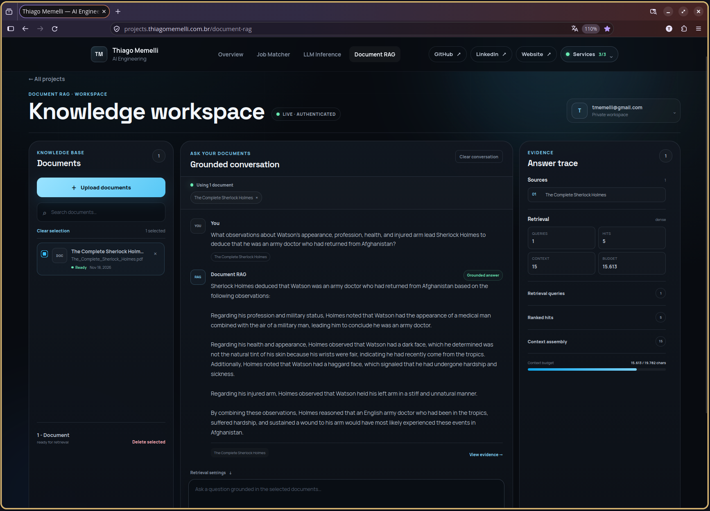

*An English question about Watson and Afghanistan, answered using a selected Sherlock Holmes document and accompanied by an inspectable Answer Trace.*

</div>

<details>
<summary><strong>See the complete product journey — landing, workspace, and question setup</strong></summary>

<br>

<div align="center">

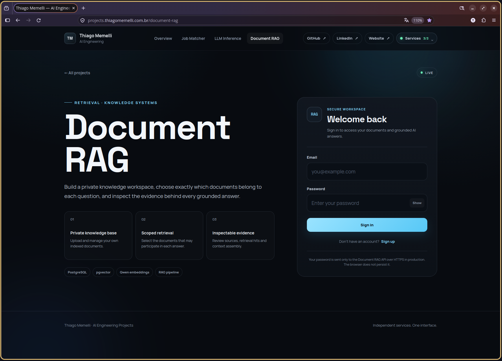

*Public landing page, product value proposition, and authentication.*

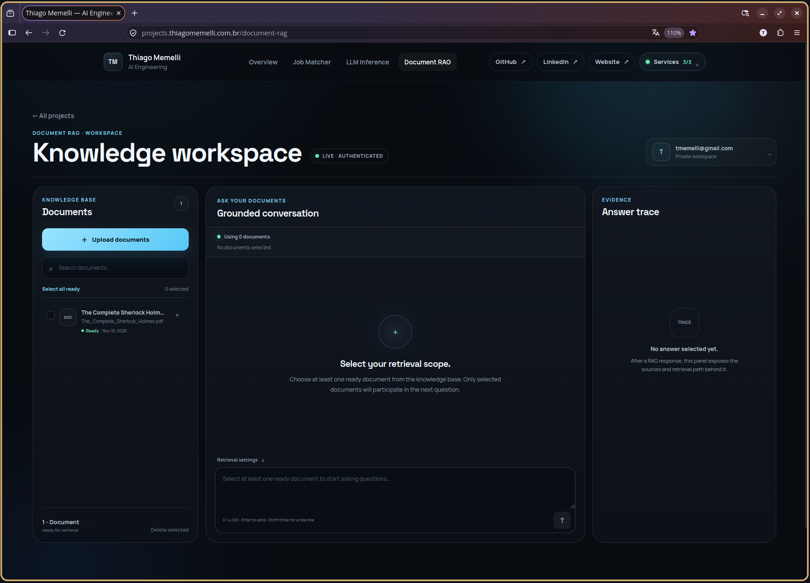

*Private workspace: document ownership, ingestion status, and explicit retrieval scope.*

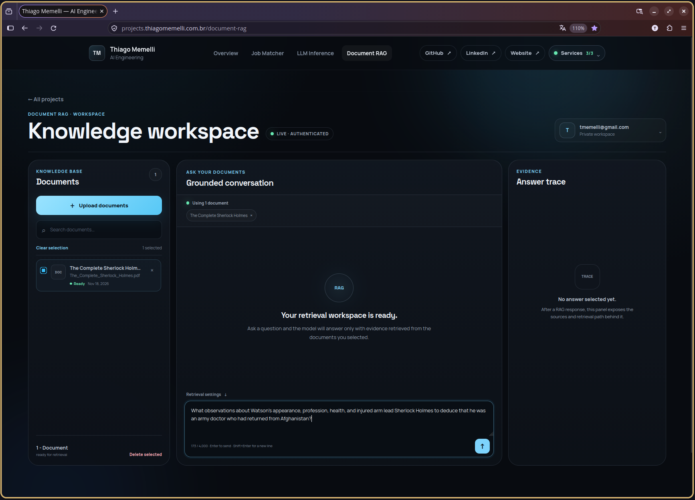

*The question is prepared before execution; only selected documents participate.*

</div>

</details>

### Answer Trace — visible engineering, not just an answer

<div align="center">

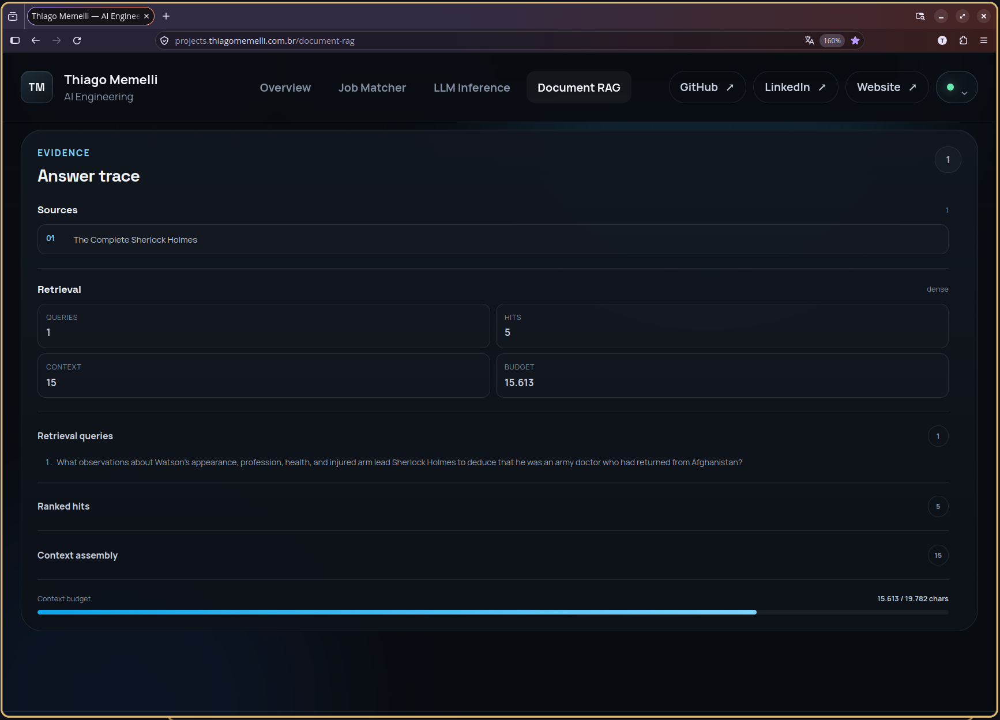

*Retrieval strategy, query count, selected documents, top-k, and context assembly.*

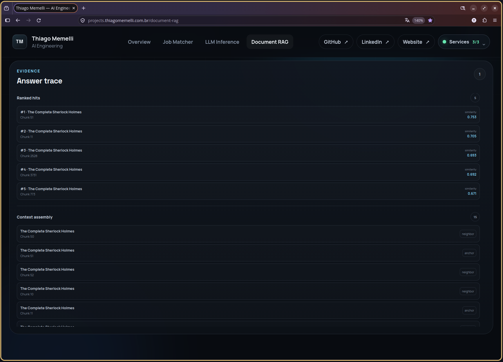

*Ranked evidence, similarities, and the difference between directly retrieved anchors and neighboring chunks.*

</div>

The demonstration uses `limit=5` and `neighbor_window=1`: five retrieval anchors can expand to **up to 15 context candidates**, before overlapping windows are deduplicated. The first ranked hit in this demonstration is **chunk #51**. **Not every candidate necessarily reaches the LLM**: the prompt budget determines the subset included in the final context.

The original PDF passage supporting this answer appears in the [Sherlock Holmes case study](#case-study).

---

## 🧩 The core idea: RAG without a RAG framework

This repository does **not** use LangChain, LlamaIndex, Haystack, or another high-level RAG orchestration layer.

That is deliberate.

It does **not** mean "no libraries." It means the project does not outsource the important retrieval behavior to a framework abstraction.

The application owns the flow explicitly:

```text
Document upload
      │
      ▼
Validation + SHA-256 duplicate detection
      │
      ▼
Text extraction
      │
      ▼
Chunking + overlap
      │
      ▼
Token-length validation
      │
      ▼
Embedding provider
      │
      ├── Local provider (development)
      │
      └── Cloudflare Workers AI (production)
      │
      ▼
PostgreSQL + pgvector
      │
      ▼
READY document
```

At query time:

```text
Authenticated user
      │
      ▼
Selected document IDs
      │
      ▼
Original query
      │
      ├───────────────┐
      │               │
      │          optional query
      │          transformation
      │               │
      │               ▼
      │        alternate queries
      │               │
      └───────┬───────┘
              ▼
       query embeddings
              │
              ▼
   pgvector cosine retrieval
              │
        ┌─────┴─────┐
        │           │
        ▼           ▼
   single query   multi-query
      dense          RRF
        │           │
        └─────┬─────┘
              ▼
        final top-k hits
              │
              ▼
      neighbor expansion
              │
              ▼
 relevance-prioritized regions
              │
              ▼
       context budget
              │
              ▼
   LLM Inference Service
              │
              ▼
 grounded answer + evidence trace
```

Every one of those stages exists as application code that can be inspected, tested, evaluated, and changed independently.

---

<a id="rag-pipeline"></a>

## 🚀 What the system does

### 📚 Private document knowledge base

Each authenticated user owns a private collection of documents. The current upload API accepts:

| Format | Extension | Extraction library |
|---|---|---|
| PDF | `.pdf` | PyMuPDF |
| Microsoft Word | `.docx` | python-docx |
| OpenDocument Text | `.odt` | odfpy |
| Rich Text Format | `.rtf` | striprtf |
| Flat OpenDocument Text | `.fodt` | odfpy |

The default upload limit is **10 MiB** (`10,485,760` bytes). The endpoint reads in bounded blocks and rejects unsupported or empty files. SHA-256 identifies duplicate content **within the current user's account**, not across users.

Documents have an explicit lifecycle:

```text
new upload → pending → processing → ready
                         │
                         └── failure / cancellation → failed
                                                     │
                                  re-upload same file └──→ pending → ...
```

`ready` duplicates are rejected; failed uploads may be retried by uploading the same bytes again, reusing the document record. Processing attempts, status transitions, and sanitized error diagnostics are persisted. See [resilient ingestion](#ingestion).

### 🔐 User-scoped retrieval

Retrieval is not global.

Every document lookup and vector query is scoped by the authenticated user. A user cannot retrieve another user's document simply by guessing an ID.

The frontend makes the retrieval scope explicit: the user selects the ready documents that may participate in the next question.

### 🔎 Dense vector retrieval

The baseline retrieval path:

1. embeds the query;
2. filters chunks by authenticated user and selected document IDs;
3. performs cosine-distance search with pgvector;
4. returns ranked chunks and similarity values.

The single-query strategy is reported as:

```text
dense
```

### 🧠 Optional query transformation

For harder questions, the system can use the separate LLM Inference Service to generate alternate retrieval queries.

The original query remains part of the retrieval set.

With the current configuration, query transformation can generate up to two additional search formulations:

```text
original query
      │
      ├── alternate query 1
      └── alternate query 2
```

Transformation is best-effort: malformed model output or provider failures are retried within the configured limit and then fall back to the **original query**, rather than failing the entire retrieval request.

This keeps generation and retrieval concerns separate: the RAG service owns retrieval, while the independent inference service owns model execution.

### 🔀 Multi-query retrieval + Reciprocal Rank Fusion

When more than one retrieval query is present, each query receives its own dense ranked list.

The lists are fused with Reciprocal Rank Fusion:

```text
RRF contribution = 1 / (rrf_k + rank)
```

The default rank constant is `60`.

Candidates are deduplicated by chunk and retain:

- fused RRF score;
- best dense similarity;
- indexes of the retrieval queries that matched them.

The resulting strategy is reported as:

```text
multi_query_rrf
```

The default per-query candidate limit is at least **10** (never below the requested final `limit`); fused ties are broken deterministically using best similarity and chunk ID.

This behavior is implemented directly in `RetrievalService`.

### 🧭 Neighbor expansion

A top-ranked chunk is often only part of the evidence.

The project therefore allows retrieval hits to be expanded with nearby chunks from the same document.

With:

```text
top_k = 5
neighbor_window = 1
```

the system may assemble up to:

```text
5 anchors × (previous + anchor + next) = 15 chunks
```

before deduplication.

The evidence trace distinguishes:

```text
anchor
neighbor
```

so context expansion remains inspectable.

### 📖 Relevance-prioritized, deterministic context ordering

A similarity-ranked list is good for finding evidence, but it can break the reading order of a passage. The **current implementation** does not globally sort every chunk by document ID. Instead:

1. Each ranked anchor creates a window of nearby chunks in the **same document**.
2. Overlapping windows are merged into contiguous **regions**.
3. Each region inherits the priority of its **highest-ranked anchor**.
4. Regions are processed in semantic-priority order; chunks **inside each region** are ordered by ascending `chunk_index`.

This preserves local narrative continuity **without pushing a highly relevant passage behind unrelated sections of the same document**. It is implemented in `ContextExpansionService` and is deterministic for a fixed retrieval ranking.

```text
ranked anchors → same-document windows → merge overlaps
              → order regions by best anchor rank
              → order chunks naturally within each region
```

This region-based ordering supersedes the earlier project design that grouped the entire context globally by document.

### 📏 Deterministic context budget

The generation service computes how many characters remain under `LLM_INFERENCE_MAX_PROMPT_CHARACTERS` **after reserving space for the question, requested language, labels, and prompt structure**. The context builder then adds **whole formatted chunks only**; it stops before the first chunk that would exceed the remaining budget.

The API deliberately distinguishes:

- `context_chunks`: **all expanded candidates**, each labeled `anchor` or `neighbor`;
- `context_chunks_count`: number of chunks **actually included** in the prompt;
- `context_characters`: exact length of the assembled context;
- `max_context_characters`: available context-character budget.

The default maximum prompt length is **20,000 characters**. This is a **character budget**, not a tokenizer-exact guarantee about the upstream LLM's token usage. If no complete chunk fits, the builder raises an explicit error instead of silently truncating a source passage.

### 🤖 Independent LLM generation service

The RAG backend delegates text generation to an independent inference API rather than implementing model-vendor execution inside the RAG service.

It integrates over HTTP with my separate **LLM Inference Service**:

```text
Document RAG Service
        │
        │ HTTP
        ▼
LLM Inference Service
        │
        ▼
provider/model execution
```

This is intentional service reuse.

The RAG application focuses on document ingestion, retrieval, context construction, and grounding. The inference project focuses on provider execution, resilience, fallback behavior, and model-specific concerns.

The generation system prompt instructs the model to use **only the provided context**, preserve concrete causal details, answer in the requested language, and explicitly say when evidence is insufficient. This is a grounding instruction, **not an independently measured guarantee of faithfulness**.

That separation made this project an exercise not only in RAG, but also in **API integration and service boundaries**.

---

## 🧪 Evaluation-driven retrieval

This is one of the project's defining engineering decisions: **a plausible generated answer is not a retrieval metric**. The evaluation asks a narrower, reproducible question: *where did the first manually labeled relevant chunk appear in the ranked list?*

The versioned dataset lives at [`evals/retrieval_cases.json`](evals/retrieval_cases.json). Each case contains:

- a stable identifier for comparing experiments;
- an English-language question;
- the document IDs allowed in the search;
- one or more `(document_id, chunk_index)` labels accepted as relevant.

For example, the Watson/Afghanistan case labels **two neighboring chunks** from the same indexed source:

```json
{
  "id": "sherlock-watson-afghanistan-deduction",
  "query": "What observations about Watson's appearance, profession, health, and injured arm lead Sherlock Holmes to deduce that he was an army doctor who had returned from Afghanistan?",
  "document_ids": [1],
  "relevant_chunks": [
    { "document_id": 1, "chunk_index": 50 },
    { "document_id": 1, "chunk_index": 51 }
  ]
}
```

**Important:** database IDs and chunk indexes refer to the **specific indexed evaluation corpus**. They are not universal identifiers for any copy of the PDF. Reindexing with different chunk settings can invalidate those labels.

The evaluation runner, [`evals/eval_retrieval.py`](evals/eval_retrieval.py), embeds each question using the configured provider, runs **single-query dense retrieval**, finds the first matching labeled chunk, and computes Hit@k and Mean Reciprocal Rank. It uses the actual application retrieval service and pgvector repository rather than a separately invented scoring function.

### The evaluation feedback loop

```text
Observe a bad or incomplete answer
           ↓
Inspect retrieved hits and context
           ↓
Locate evidence in the source document
           ↓
Record stable relevance labels
           ↓
Run the dense baseline
           ↓
Experiment with retrieval behavior
           ↓
Compare rankings and inspect again
```

That workflow is why the project includes neighbor expansion, optional query transformation, multi-query RRF, explicit context budgeting, and Answer Trace diagnostics: **each mechanism can be reasoned about and tested independently**. Their existence does not mean they all improved the dense baseline; strategy-specific comparisons are a future evaluation step.

---

<a id="case-study"></a>

## 🕵️ The Sherlock Holmes case — from retrieval failure to verifiable evidence

The original debugging problem was a deceptively specific Sherlock Holmes question: a visitor arriving at Baker Street, clues about **a return train ticket and mud on her left sleeve**, and Holmes's inference about travel by train and open carriage. Early retrieval returned semantically similar passages without consistently retrieving the decisive clue. That showed why **a fluent answer can hide a retrieval failure**.

The original debugging case helped motivate instrumentation, neighbor expansion and labeled evaluation. **It is not one of the current 30 English-language benchmark cases**; the published baseline uses the dataset in `evals/retrieval_cases.json`.

### A source-verified live demonstration: Watson and Afghanistan

The current live demo asks:

> What observations about Watson's appearance, profession, health, and injured arm lead Sherlock Holmes to deduce that he was an army doctor who had returned from Afghanistan?

The source passage connects a medical appearance and military bearing with tropical exposure, signs of hardship and illness, and an injured left arm. Holmes infers an army doctor returning from Afghanistan. In the demo's dense ranking, **chunk #51** is the first hit; the evaluation case accepts chunks **#50 and #51** as relevant in the indexed document.

<div align="center">

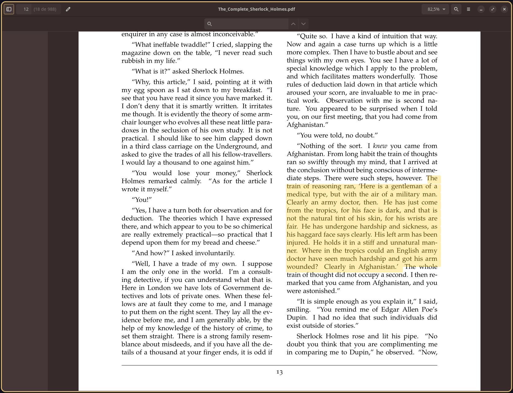

*Highlighted source evidence from the original PDF. This is a document screenshot, not a generated quotation.*

</div>

The source screenshot is the **PDF viewer's page 18 of 988**, displaying printed book page **13**. Those are different page-numbering systems; the evaluation uses **zero-based chunk indexes**, not PDF page numbers.

The central principle is simple: **the source passage, the retrieved chunk, the context actually sent, and the final answer should be independently inspectable**. This is more valuable than relying on an impressive-looking answer alone.

---

<a id="evaluation"></a>

## 📊 Dense retrieval baseline — 30 cases

The current benchmark is a **single-query dense retrieval** evaluation over **30 English-language Sherlock Holmes questions**. It uses Cloudflare Workers AI's Qwen3 embedding model, with application vectors stored at **512 dimensions** in pgvector.

<div align="center">

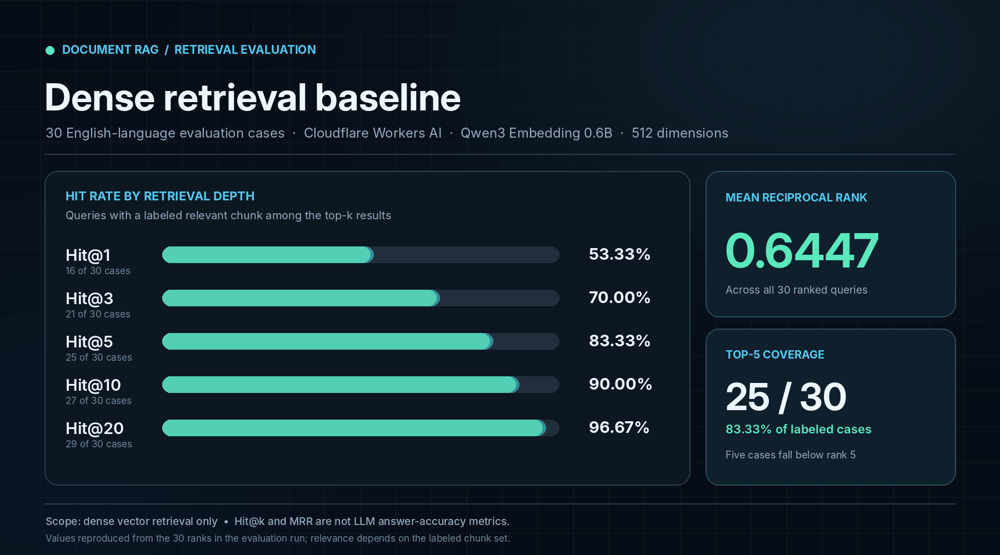

*Aggregate retrieval metrics, calculated from the ranks reported by the evaluation runner.*

</div>

| Metric | Score | Labeled hits |
|---|---:|---:|
| **Hit@1** | **53.33%** | 16/30 |
| **Hit@3** | **70.00%** | 21/30 |
| **Hit@5** | **83.33%** | 25/30 |
| **Hit@10** | **90.00%** | 27/30 |
| **Hit@20** | **96.67%** | 29/30 |
| **MRR** | **0.6447** | Mean reciprocal rank across all 30 cases |

<div align="center">

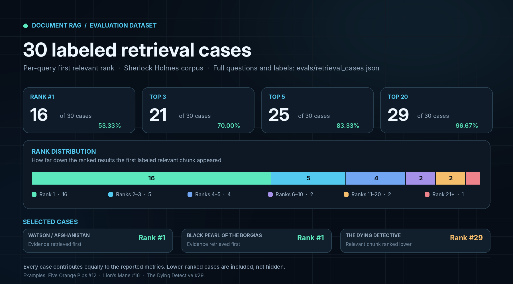

*Case-level overview; the full labeled cases remain available as JSON in the repository.*

</div>

### Evaluation configuration

```text
strategy  = single-query dense retrieval
provider  = cloudflare
model     = @cf/qwen/qwen3-embedding-0.6b
dimension = 512
cases     = 30
```

**Metric definitions** for a dataset with `N` questions and first relevant ranks `rᵢ`:

```text
Hit@k = count(rᵢ <= k) / N
MRR   = (1/N) × Σ (1/rᵢ)       [0 for missing relevant ranks]
```

The evaluation fetches a sufficiently deep ranked list to locate the first **labeled** relevant chunk. It is not measuring response generation, prompt faithfulness, or source citation correctness.

### Examples worth inspecting

| Case | First labeled relevant rank | Interpretation |
|---|---:|---|
| Watson's Afghanistan deduction | **#1** | Source evidence surfaced immediately |
| Black Pearl of the Borgias | **#1** | Strong top-ranked retrieval |
| Five Orange Pips warning | **#12** | Evidence found, but too deep for a typical top-5 context |
| Lion's Mane / *Cyanea* | **#16** | Ranking remains a bottleneck |
| The Dying Detective / ivory box | **#29** | Not found within the top 20 despite being present deeper |

**What the numbers suggest:** relevant labeled evidence is often found by depth 20 (29/30), but only 16/30 cases rank it first. Improving candidate ranking is therefore a sensible next experiment. **This is a hypothesis**, not evidence that reranking, hybrid search or query decomposition have already been implemented or benchmarked.

### Methodology, reproducibility, and limitations

- **Scope:** single-query **dense** retrieval only. Optional query transformation and `multi_query_rrf` are implemented in the application but **not measured by these scores**.
- **Labels:** the 30 cases have manually selected relevant chunk IDs. The IDs were compared with an exported corpus snapshot, but the labels are **not exhaustive independent relevance judgments**. Unlabeled relevant passages may exist.
- **Snapshot dependence:** document IDs and chunk indexes depend on the indexed corpus and chunking configuration. A fresh installation will need its own corpus, account and validated labels.
- **Runner setup:** [`evals/eval_retrieval.py`](evals/eval_retrieval.py) currently contains a fixed evaluation-user email and the JSON contains fixed document IDs. Adjust these to your own test data **before running or publishing personal identifiers**.
- **Verification status:** the reported ranks were supplied by the project evaluation run and their aggregate arithmetic was checked. They are **not presented as a new independent benchmark execution**.
- **What is not measured:** LLM answer accuracy, groundedness, hallucination rate, latency, throughput, recall of all possible relevant passages, or the multi-query strategy.

```bash
# Requires a configured database with the matching indexed evaluation corpus,
# a matching evaluation user, and Cloudflare embedding credentials.
uv run python evals/eval_retrieval.py
```

[View labeled cases](evals/retrieval_cases.json) · [View evaluation runner](evals/eval_retrieval.py) · [View chunk export utility](evals/export_chunks.py)

The point of this baseline is not to claim that retrieval is solved. It provides a **measured starting point** for future experiments on the same evidence labels.

---

## 🔍 Retrieval observability

A RAG system is much easier to debug when the answer is not the only thing returned.

`POST /v1/rag/query` exposes:

- answer;
- sources;
- retrieval strategy;
- retrieval queries;
- ranked retrieval hits;
- document IDs and titles;
- chunk indexes;
- fused score;
- best similarity;
- matched query indexes;
- context chunks;
- `anchor` / `neighbor` role;
- context chunk count;
- current context characters;
- maximum context characters.

This is what powers the frontend **Answer Trace**.

The user can inspect not only:

> "What did the model answer?"

but also:

> "What did retrieval search for, what was ranked, and what context was assembled?"

That observability has been one of the most useful tools during development.

---

### Understanding the Answer Trace fields

| Field | Meaning |
|---|---|
| `retrieval_strategy` | `dense` or `multi_query_rrf` |
| `retrieval_queries` | Normalized search queries actually executed |
| `retrieval_hits` | Ranked anchor chunks with score, best dense similarity, and matching query indexes |
| `context_chunks` | Expanded **candidate** chunks, each with `anchor`/`neighbor` role |
| `context_chunks_count` | Number of complete chunks **included** in the LLM context |
| `context_characters` | Length of the context actually assembled |
| `max_context_characters` | Available context-character budget for that question |
| `sources` | Unique document titles represented in the **included** context |

**Do not confuse `score` with cosine similarity in multi-query mode.** For `dense`, the score is cosine similarity (`1 - distance`). For `multi_query_rrf`, `score` is the **fused RRF score**, while `best_similarity` preserves the best observed dense similarity. The UI can display both without pretending they are the same quantity.

The trace describes the retrieval path and context assembly. It is **not** a guarantee that the model's final wording is perfectly faithful to every source; evaluating that requires separate answer-level tests.

---

<a id="ingestion"></a>

## 🧬 Resilient document ingestion

Ingestion is designed as a **recoverable state machine**, not merely an upload endpoint that hopes every remote embedding call finishes. The implementation distinguishes durable lifecycle records from the transaction that writes chunks and marks a document ready.

### The normal path

```text
POST /v1/documents/upload
          │
          ▼
Validate filename, extension, non-empty bytes and size (10 MiB default)
          │
          ▼
Compute SHA-256 and check duplicates within the authenticated user
          │
          ▼
Create document + pending status history
          │
          ▼
Extract text (.pdf / .docx / .odt / .rtf / .fodt)
          │
          ▼
Chunk with character overlap and tokenizer-aware length validation
          │
          ▼
Atomic pending → processing claim + unique fencing token + lease
          │
          ▼
Embed document chunks (Cloudflare or local provider)
          │
          ▼
Write chunks and vectors + fenced processing → ready transition
          │
          ▼
Commit chunk data + ready status + attempt history
```

Text is extracted and normalized, chunked at configurable character boundaries (`1000` with `200` overlap in the example environment), then checked against the embedding model's tokenizer limit. The embedding provider may make multiple remote requests; the system does **not** hold a single transaction open as its only record of processing state.

### Explicit lifecycle and retries

```text
new → pending → processing → ready
                        │
                        └─ failure / cancellation → failed
                                                    │
                    re-upload same file (same user) ┘
                                    ↓
                              pending → processing → ready

processing + expired/missing lease
    → recover interrupted attempt as failed
    → record interruption and reserve new attempt
    → pending → processing → ready
```

- A `ready` duplicate is rejected; a `pending` duplicate or a document with an **active** processing lease is not claimed twice.
- Re-uploading identical bytes after `failed` **reuses the same document ID** and increments the attempt number.
- An interrupted `processing` record is recovered only when its lease is **expired or missing**; active leases are not stolen.
- There is **no public `/retry` route** and no always-running recovery daemon. Recovery is triggered by a subsequent upload of the same content.
- The upload request currently performs ingestion **synchronously**; background queues and worker orchestration are future improvements.

### Lease, heartbeat, and fencing: why all three?

| Mechanism | Current behavior | Failure it prevents |
|---|---|---|
| **Atomic claim** | Conditional database update moves `pending` to `processing` | Two workers claiming the same pending document |
| **Processing lease** | Expires after **120 seconds** by default | A crashed worker blocking retries indefinitely |
| **Heartbeat** | Separate DB session renews the lease every **30 seconds** by default | Long Cloudflare calls being mistaken for abandoned work |
| **Fencing token** | Unique token required for `ready`/`failed` updates | An old worker overwriting a newer attempt after losing ownership |
| **Attempt number** | History tracks each retry and transition | Losing the timeline of failed and recovered processing |

The heartbeat duration must be shorter than the lease duration. If renewal stops, the lease can eventually expire; an older worker cannot commit stale results after a newer attempt takes ownership. The heartbeat task is canceled and awaited when foreground ingestion finishes.

### Transactional integrity and failure handling

During chunk persistence, the service creates the chunk rows and performs the fenced `processing → ready` update in the same transaction. If embedding or persistence fails, the transaction is rolled back so **partial chunks do not remain as a successful ingestion**. Failure status and diagnostics are then recorded in a separate transaction when the attempt still owns its token.

The code also handles `asyncio.CancelledError` explicitly and records a retryable interruption when possible. A hard process crash may prevent that immediate write; the **lease-recovery path** exists for exactly that case.

### Operational history and structured error events

The database stores two complementary audit trails:

| Table | Records |
|---|---|
| `document_status_history` | From/to status, component, operation, attempt number, timestamp and JSON details |
| `error_events` | Error classification, code, operation, retryability, attempt number, optional document/correlation ID, and structured details |

Known Cloudflare errors are decomposed into fields such as provider, HTTP status, provider code and provider message. Diagnostic strings are length-bounded and common credential patterns are redacted before persistence. This is useful for investigating a failed ingestion **without relying only on ephemeral Render logs**.

These controls address a concrete production failure mode: an interrupted upload can otherwise leave a document permanently stuck in `processing`, even when the user retries the same file. The recovery protocol makes that state diagnosable and recoverable.

---

## ☁️ Embedding architecture and adaptive Cloudflare batching

The application exposes an `EmbeddingProvider` contract with local and Cloudflare implementations. The rest of the RAG pipeline depends on that contract rather than on one provider's HTTP format or Python SDK.

### Production: Cloudflare Workers AI

| Setting | Value in the supplied example configuration |
|---|---|
| Embedding provider | `cloudflare` |
| Remote model | `@cf/qwen/qwen3-embedding-0.6b` |
| Matching tokenizer | `Qwen/Qwen3-Embedding-0.6B` |
| Stored vector dimension | `512` |
| Maximum attempted document batch | `32` texts |
| Model input sequence limit | `8192` tokenizer tokens |
| HTTP timeout | `30` seconds |
| Maximum transient attempts | `3` |

Cloudflare performs the embedding inference remotely. The application uses the matching Hugging Face `AutoTokenizer` **locally to count tokens** before sending document chunks; the production API does **not** load the local embedding model for inference.

The provider sends document inputs as `documents` and query inputs as `queries`, validates the response shape and vector count, truncates returned vectors to the configured dimension, and L2-normalizes the resulting vectors. The database column is explicitly `Vector(512)` in the current schema, so dimension changes require a coordinated migration and re-embedding plan.

### Why tokenizer validation alone did not solve request sizing

A locally counted token limit protects **individual chunks**, but Cloudflare can still reject the **aggregate payload** of many individually valid texts. Treating `32` as a guaranteed safe batch size produced an actual provider failure: **HTTP 400 / error code 3030 (`input too big`)**.

The fix was **adaptive batching**. The configured batch size is now an **optimistic upper bound**, not an assumption about the provider's aggregate payload acceptance:

```text
Attempt document batch (up to 32 texts)
                │
         Cloudflare response
                │
     ┌──────────┴───────────────┐
     │                          │
   success              HTTP 400 / code 3030
     │                          │
 validate vectors       split batch in half
     │                     ┌────┴────┐
 return in order        left       right
                          │           │
                     recurse       recurse
                          └────┬──────┘
                        concatenate in order
```

A single oversized text cannot be split at the **batch** layer and fails explicitly; the chunking/token-limit layer is responsible for preventing that situation. The recursive split completes the left half before the right half so embedding-to-chunk order remains stable.

### Transient errors are a different class of failure

The provider does **not** blindly retry deterministic input-too-large errors. It retries transient **HTTP 408, 429, and 500–504** responses, as well as transport errors, up to a configured attempt limit. A numeric `Retry-After` is respected when present; otherwise the provider uses exponential backoff.

| Failure | Response |
|---|---|
| HTTP 400 + Cloudflare code `3030` | Recursively halve document batch; no pointless identical-payload retry |
| HTTP 408 / 429 / 500–504 | Bounded retry with delay |
| Network / transport error | Bounded retry with exponential backoff |
| Invalid JSON, wrong vector count or malformed payload | Explicit failure; no silent partial success |
| Single text still too large | Explicit failure for the ingestion pipeline to record |

This is an important engineering distinction: **local token counting, aggregate request sizing, and transient provider availability are three different concerns** and require different controls.

### Development: optional local embedding provider

The local provider remains available for experiments and development:

```bash
uv sync --extra local
```

Set `EMBEDDING_PROVIDER=local` and choose a compatible device (for example `cpu` on a machine without CUDA). Production deployment uses Cloudflare to avoid installing and running the heavier local inference stack on a small Render instance. Both paths must produce vectors compatible with the stored pgvector dimension; changing providers/models can require reindexing.

---

## 🛡️ Authentication, isolation, and API protection

The public application is multi-user.

Security-related behavior includes:

- JWT bearer authentication;
- issuer and audience validation;
- configurable token expiration;
- Argon2 password hashing;
- email validation;
- per-user document ownership;
- per-user vector retrieval;
- other users' documents hidden behind `404`;
- upload size enforcement;
- SHA-256 duplicate detection;
- CORS configuration;
- registration rate limiting;
- login rate limiting;
- upload rate limiting;
- RAG query rate limiting;
- account deletion;
- cascading cleanup of owned data.

Current default rate-limit settings include:

```text
register: 3 / minute
login:    5 / minute
upload:   3 / minute
RAG:      5 / minute
```

---

### Enforcement boundaries and limitations

- **JWT:** signed bearer tokens are validated for signature, issuer, audience and expiry; passwords are hashed with **Argon2**. `AUTH_JWT_SECRET` must contain **at least 32 characters**.
- **Document ownership:** API lookups and vector searches are constrained to the authenticated user. Unavailable or foreign document IDs are not disclosed as another user's data.
- **Upload protection:** supported file extensions, incremental reads with a 10 MiB default limit, and user-scoped SHA-256 duplicate detection.
- **CORS:** only configured frontend origins may read cross-origin API responses.
- **Rate limiting:** the current sliding-window limiter is **in-process**. It is appropriate for the current single-instance setup but is **not distributed** across multiple workers or replicas.
- **Deletion:** document deletion and password-confirmed account deletion use cascading relational cleanup.

The lightweight `GET /health` route confirms that the API process responds; it does not run deep checks of PostgreSQL, Cloudflare, or the inference provider. The frontend monitor reflects that distinction.

---

## 💸 Cost-aware production architecture & global health UX

The public portfolio deliberately uses a small, cost-conscious deployment. Free-tier constraints are treated as **engineering trade-offs**, not as enterprise-grade uptime guarantees.

```text
                     https://projects.thiagomemelli.com.br
                        Unified React / Vite frontend
                                     │
              ┌──────────────────────┼───────────────────────┐
              │                      │                       │
              ▼                      ▼                       ▼
       Document RAG API       LLM Inference API        AI Job Matcher API
        FastAPI · Render        Render service           Render service
              │                      ▲
       ┌──────┼────────┐             │
       │      │        │             │
       ▼      ▼        └─────────────┘
     Neon   Cloudflare      HTTP text generation
 PostgreSQL Workers AI
 + pgvector Qwen3 embeddings
```

| Component | Responsibility |
|---|---|
| [Unified frontend](https://github.com/tmemelli/projects-frontend) | One portfolio domain, consistent UI, project routes and global service-health monitor |
| [Document RAG API](https://document-rag-service.onrender.com/docs) | Authenticated documents, ingestion, retrieval, context and grounding |
| [LLM Inference Service](https://github.com/tmemelli/llm-inference-service) | Separate HTTP service for model/provider execution and inference policies |
| Neon PostgreSQL + pgvector | Relational ownership, ingestion history and vector search |
| Cloudflare Workers AI | Remote document/query embedding inference |
| Render | Independently deployed API instances with possible free-tier cold starts |

### Why one frontend and independent backends?

The shared `projects-frontend` exposes `/job-matcher`, `/llm-inference`, and `/document-rag` under the same domain and visual system. Each backend retains its own API, deployment and responsibility. This avoids duplicating frontend hosting while demonstrating **service boundaries and integration over HTTP**.

### Global Services monitor — a visitor-facing cold-start improvement

The frontend now includes a compact **Services** indicator beside `Website` in the global header. It probes the `/health` endpoints for **all three backends**, not just Document RAG.

- Sends an initial round of checks when the visible portfolio loads.
- Rechecks approximately **every 10 minutes** while the tab remains visible, online and active.
- Displays a **3/3 ready** summary when all three readable responses succeed, plus individual states, last-check timestamps, a countdown, and **Check now**.
- Shows `Checking`, `Waking / slow`, `Ready`, `Unverified`, `Unavailable`, or `Paused` as appropriate.
- Pauses monitoring for hidden/offline tabs and after **20 minutes without interaction**, reducing unnecessary free-tier consumption.
- Does **not** equate a `no-cors` opaque response with HTTP 200. If the browser cannot verify a response, the state is **Unverified**.

A slow response may reflect a sleeping Render instance starting up. The UI is designed to communicate that possibility without blocking the page. The monitor is a **client-side UX and warmup mechanism**, not an uptime monitor, SLA, background daemon, or guarantee that all service dependencies are healthy.

The code for the monitor lives in the [frontend repository](https://github.com/tmemelli/projects-frontend), not in the RAG backend. It is a useful example of balancing **visitor experience, cold starts and shared free-tier compute limits**.

---

<a id="architecture"></a>

## 🏗️ Architecture & repository layout

The project is intentionally split into HTTP contracts, application services, persistence repositories, providers and configuration. The RAG orchestration is explicit, while reusable infrastructure concerns are isolated behind small interfaces.

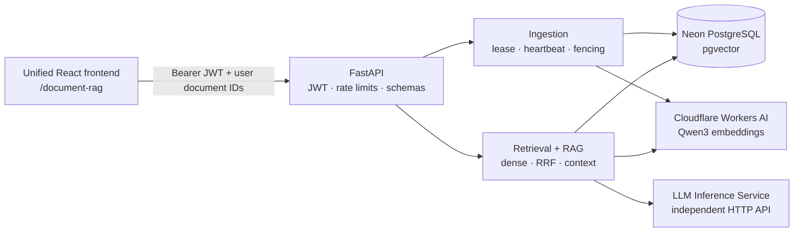

### Codebase map

```text
document-rag-service/
├── src/document_rag_service/
│   ├── api/
│   │   ├── routes.py                   # HTTP endpoints and validation
│   │   ├── dependencies.py             # Auth + request-scoped composition
│   │   ├── rate_limiter.py             # In-process sliding window
│   │   ├── exception_handlers.py
│   │   └── schemas/                    # Pydantic contracts
│   ├── core/
│   │   ├── settings.py                 # Validated environment configuration
│   │   ├── lifespan.py                 # Shared clients and resource lifecycle
│   │   └── embedding_provider_factory.py
│   ├── db/                             # Async SQLAlchemy sessions
│   ├── models/                         # User, document, chunk, status, errors
│   ├── repositories/                   # SQL/pgvector and atomic lease updates
│   ├── providers/
│   │   ├── cloudflare_embedding_provider.py
│   │   ├── local_embedding_provider.py
│   │   └── llm_inference_provider.py
│   ├── services/
│   │   ├── document_service.py         # Ownership, checksum, retry reservation
│   │   ├── ingestion_service.py        # Extraction, persistence, recovery
│   │   ├── chunking_service.py         # Overlap and token-safe splitting
│   │   ├── embedding_service.py        # Provider contract
│   │   ├── retrieval_service.py        # Dense search and RRF
│   │   ├── query_transformation_service.py
│   │   ├── context_expansion_service.py
│   │   ├── context_builder_service.py
│   │   ├── generation_service.py
│   │   ├── rag_service.py              # End-to-end orchestration
│   │   └── auth/user/checksum/text services
│   ├── main.py
│   └── py.typed
├── migrations/                         # Alembic versioned schema changes
├── evals/
│   ├── retrieval_cases.json            # 30 English questions and labels
│   ├── eval_retrieval.py               # Dense ranking evaluation
│   ├── embedding_benchmark.py
│   └── export_chunks.py
├── tests/
│   ├── unit/
│   ├── integration/
│   └── manual/                         # Direct debug/smoke scripts
├── docs/assets/                       # Product, evidence and evaluation PNGs
├── .env.example
├── alembic.ini
├── pyproject.toml
├── uv.lock
├── README.md
└── README.pt-BR.md
```

### Layer responsibilities

| Layer | Responsibility |
|---|---|
| `api` | Versioned HTTP routes, schemas, bearer dependencies, validation, rate limits, errors |
| `services` | Use-case orchestration, document lifecycle, retrieval, context assembly, generation |
| `repositories` | User-scoped SQL/pgvector queries, atomic processing claims, fenced updates |
| `models` | SQLAlchemy persistence schema and relational integrity |
| `providers` | Cloudflare/local embedding inference and external LLM HTTP integration |
| `core` / `db` | Validated settings, lifespan resources, async database sessions |
| `evals` | Labeled retrieval dataset, baseline runner and inspection utilities |
| `tests` | Unit, PostgreSQL integration and manual end-to-end verification |

### Database integrity and migrations

Alembic tracks the schema evolution, including users and ownership, document chunks and embeddings, status history, structured errors, cascading cleanup, the 512-dimensional vector migration and processing leases. In the supplied source snapshot, the latest lease migration is **`4f8c1a2d9b73`**. Use `uv run alembic upgrade head` rather than manually creating tables in a running deployment.

Each chunk is uniquely identified within its document by `(document_id, chunk_index)`; foreign keys use cascades where appropriate. Retrieval joins chunks to owned documents to enforce access control at the query layer.

---

## 🛠️ Technology stack

| Area | Technology | Purpose |
|---|---|---|
| Language | Python 3.12+ | Core implementation |
| API | FastAPI | Async HTTP API, DI, OpenAPI |
| ORM | SQLAlchemy 2 | Async persistence |
| Database | PostgreSQL | Users, documents, lifecycle metadata |
| Vector search | pgvector | Cosine-distance retrieval |
| Migrations | Alembic | Versioned database schema |
| Embeddings | Qwen3 Embedding | Document/query vectors |
| Production embeddings | Cloudflare Workers AI | Remote embedding inference |
| Local embeddings | sentence-transformers | Optional local development path |
| Tokenization | Transformers `AutoTokenizer` | Matching tokenizer / token counting |
| HTTP clients | httpx | Cloudflare + LLM service integration |
| Validation | Pydantic / pydantic-settings | API schemas and environment validation |
| Password hashing | Argon2 | Credential storage |
| Authentication | JWT | Stateless bearer authentication |
| PDF parsing | PyMuPDF | PDF text extraction |
| DOCX parsing | python-docx | Word extraction |
| ODT/FODT parsing | odfpy | OpenDocument extraction |
| RTF parsing | striprtf | RTF extraction |
| Tests | pytest + pytest-asyncio | Unit/integration coverage |
| Coverage | pytest-cov | Coverage reporting |
| Static typing | mypy | Type checking |
| Linting | Ruff | Code quality |
| Package manager | uv | Environment and lockfile |

---

<a id="api"></a>

## 🌐 API & examples

<div align="center">

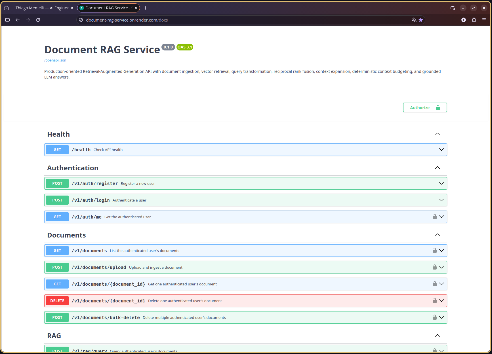

*Live OpenAPI documentation: [Swagger UI](https://document-rag-service.onrender.com/docs).*

</div>

| Method | Endpoint | Purpose |
|---|---|---|
| `GET` | `/health` | Lightweight process health response |
| `POST` | `/v1/auth/register` | Create user and issue bearer token |
| `POST` | `/v1/auth/login` | Authenticate and issue bearer token |
| `GET` | `/v1/auth/me` | Return authenticated user |
| `GET` | `/v1/documents` | List owned documents |
| `POST` | `/v1/documents/upload` | Upload, synchronously ingest or retry failed content |
| `GET` | `/v1/documents/{document_id}` | Read owned document metadata |
| `DELETE` | `/v1/documents/{document_id}` | Delete one owned document |
| `POST` | `/v1/documents/bulk-delete` | Validate and delete multiple owned documents |
| `POST` | `/v1/rag/query` | Grounded answer and retrieval diagnostics |
| `POST` | `/v1/account/delete` | Password-confirmed account deletion |

### Authentication flow

Registration and login accept email/password JSON and return an `access_token`, `token_type: bearer`, and public user information. Protected routes require `Authorization: Bearer <access_token>`. Passwords are not stored in plaintext.

```bash
# Example only: supply your own account and local API URL.
curl -X POST http://127.0.0.1:8000/v1/auth/login \
  -H 'Content-Type: application/json' \
  -d '{"email":"user@example.com","password":"replace-with-your-password"}'
```

### Upload a document

```bash
curl -X POST http://127.0.0.1:8000/v1/documents/upload \
  -H "Authorization: Bearer $ACCESS_TOKEN" \
  -F 'file=@/path/to/your-document.pdf' \
  -F 'title=My knowledge source'
```

The API uses the file extension to choose a supported parser. The `title` field is optional. Uploading a duplicate `ready` document is rejected; re-uploading previously failed content can start a new attempt on the same document ID.

### Execute a grounded query

```json
{
  "document_ids": [1],
  "query": "What observations about Watson's appearance, profession, health, and injured arm lead Sherlock Holmes to deduce that he was an army doctor who had returned from Afghanistan?",
  "language": "en",
  "limit": 5,
  "neighbor_window": 1,
  "transform_query": false
}
```

```bash
curl -X POST http://127.0.0.1:8000/v1/rag/query \
  -H "Authorization: Bearer $ACCESS_TOKEN" \
  -H 'Content-Type: application/json' \
  -d '{"document_ids":[1],"query":"What observations lead Holmes to deduce that Watson returned from Afghanistan?","language":"en","limit":5,"neighbor_window":1,"transform_query":false}'
```

The request schema accepts **1–100 document IDs**, question length up to **4,000 characters**, `limit` from **1–20**, and `neighbor_window` from **0–5**. `transform_query` is optional and defaults to `false`. The selected documents must be owned by the user and in `ready` state.

### Response observability contract

```text
answer
sources
retrieval_strategy
retrieval_queries
retrieval_hits[]:
  document_id, document_title, chunk_index,
  score, best_similarity, matched_query_indexes
context_chunks[]:
  document_id, document_title, chunk_index, role
context_chunks_count
context_characters
max_context_characters
```

A consumer can display the answer alone, or use the additional fields to explain which evidence was ranked and which context candidates were assembled. The current API returns **source document titles**, not a formally verified per-sentence citation map.

---

## ✅ Testing, quality & verification strategy

The repository includes **unit tests, real PostgreSQL/pgvector integration tests, and direct manual smoke-test scripts**. The test strategy evolved with the application: first validate behavior locally against the working stack, then harden it with automated tests before deployment.

### What is covered

| Area | Examples of covered behavior |
|---|---|
| Authentication and API | Registration/login, JWT validation, ownership, account deletion, rate limits |
| Document lifecycle | Upload validation, checksum duplicates, failed retries, status transitions |
| Recovery | Atomic claims, lease expiry, heartbeat renewal, fencing, cancellation and rollback |
| Cloudflare integration | Response validation, adaptive batch split on code `3030`, transient retries and vector normalization |
| Retrieval | User-scoped pgvector search, dense ranking, multi-query RRF, deterministic ties |
| Context | Neighbor windows, merged regions, semantic priority, complete-chunk budgeting |
| Generation | Prompt construction, language handling, context limits and provider errors |
| Database | Real SQLAlchemy/PostgreSQL constraints, cascade behavior and repository integration |
| End-to-end API | Authenticated document operations and grounded query response contracts |

### Run the automated suite

```bash
# Requires a local PostgreSQL server and the dedicated integration database.
uv run pytest

# Linting, formatting and static type checking.
uv run ruff check .
uv run ruff format --check .
uv run mypy src tests

# Fresh coverage measurement (not a cached README claim).
uv run pytest --cov=src/document_rag_service --cov-report=term-missing
```

**Integration-test safety:** `tests/integration/conftest.py` explicitly restricts database integration tests to a local PostgreSQL host and uses the dedicated database name **`document_rag_test_db`** with rollback/savepoint isolation. Create and migrate that test database separately; **never point tests at Neon production**.

### Manual smoke tests

The `tests/manual/` directory includes debug scripts for ingestion, queries, complete RAG execution and registration. These are useful for verifying real provider/DB behavior after changing architecture or deployment configuration.

```bash
# Example: inspect the manual scripts and their arguments before execution.
uv run python tests/manual/debug_query.py --help
uv run python tests/manual/debug_ingestion.py --help
```

### What is and is not claimed

Earlier documentation included specific historical pytest and coverage totals. Those totals are **not repeated here** because this README revision did not rerun the entire suite or produce a new coverage report. The commands above are the reproducible quality gates; current counts should be published only with the corresponding test output.

Likewise, the retrieval benchmark measures ranking against labels, not unit-test coverage or generated-answer correctness. Keeping these measurements separate is part of the project's evaluation discipline.

---

## ⚙️ Configuration

Configuration is loaded through `pydantic-settings` from environment variables and a local `.env` file, with validation at startup. The checked-in [`.env.example`](.env.example) is the authoritative template; **do not commit real credentials**.

### Database, HTTP and limits

| Variable | Example / default | Purpose |
|---|---|---|
| `POSTGRES_HOST`, `POSTGRES_PORT`, `POSTGRES_DB` | `localhost`, `5432`, `document_rag_db` | PostgreSQL location |
| `POSTGRES_USER`, `POSTGRES_PASSWORD` | `document_rag_user`, placeholder | Database credentials |
| `POSTGRES_SSLMODE` | `prefer` in example | TLS policy; configure for your database |
| `CORS_ALLOWED_ORIGINS` | localhost + portfolio domain | Frontend origins allowed to read the API |
| `DOCUMENT_UPLOAD_MAX_SIZE_BYTES` | `10485760` | 10 MiB upload limit |
| `AUTH_REGISTER_RATE_LIMIT_PER_MINUTE` | `3` | Registration throttle |
| `AUTH_LOGIN_RATE_LIMIT_PER_MINUTE` | `5` | Login throttle |
| `DOCUMENT_UPLOAD_RATE_LIMIT_PER_MINUTE` | `3` | Upload throttle |
| `RAG_RATE_LIMIT_PER_MINUTE` | `5` | Query throttle |

### Ingestion and embedding

| Variable | Example value | Purpose |
|---|---|---|
| `CHUNK_SIZE` | `1000` | Approximate maximum characters per chunk |
| `CHUNK_OVERLAP` | `200` | Overlap in characters |
| `DOCUMENT_PROCESSING_LEASE_SECONDS` | `120` | Processing ownership lease |
| `DOCUMENT_PROCESSING_HEARTBEAT_SECONDS` | `30` | Lease renewal interval; must be shorter than lease |
| `EMBEDDING_PROVIDER` | `cloudflare` | Select `cloudflare` or `local` |
| `EMBEDDING_MODEL` | `Qwen/Qwen3-Embedding-0.6B` | Tokenizer/local model identifier |
| `EMBEDDING_DIMENSION` | `512` | Application vector dimension; DB schema is fixed to 512 |
| `EMBEDDING_DEVICE` | `cuda` | Local-only inference device; use `cpu` if appropriate |
| `CLOUDFLARE_ACCOUNT_ID` / `CLOUDFLARE_API_TOKEN` | placeholders | Required for Cloudflare provider |
| `CLOUDFLARE_EMBEDDING_MODEL` | `@cf/qwen/qwen3-embedding-0.6b` | Remote embedding model |
| `CLOUDFLARE_EMBEDDING_MAX_SEQUENCE_LENGTH` | `8192` | Individual text token limit |
| `CLOUDFLARE_EMBEDDING_BATCH_SIZE` | `32` | Optimistic maximum document batch |
| `CLOUDFLARE_TIMEOUT_SECONDS` | `30.0` | Provider request timeout |
| `CLOUDFLARE_MAX_ATTEMPTS` | `3` | Bounded transient retries |
| `CLOUDFLARE_RETRY_BASE_DELAY_SECONDS` | `1.0` | Exponential backoff base |

### LLM inference, transformation and JWT

| Variable | Example value | Purpose |
|---|---|---|
| `LLM_INFERENCE_BASE_URL` | `https://llm-inference-service-g4os.onrender.com` | Independent inference API |
| `LLM_INFERENCE_PROVIDER` | `gemini` in `.env.example` | Inference provider; runtime-configurable |
| `LLM_INFERENCE_MODEL` | `gemini-3.1-flash-lite` in `.env.example` | Model identifier; runtime-configurable |
| `LLM_INFERENCE_TEMPERATURE` | `0.0` | Generation temperature |
| `LLM_INFERENCE_MAX_TOKENS` | `2000` | Output-token ceiling |
| `LLM_INFERENCE_TIMEOUT_SECONDS` | `120.0` | Inference HTTP timeout |
| `LLM_INFERENCE_MAX_PROMPT_CHARACTERS` | `20000` | Prompt-character ceiling |
| `QUERY_TRANSFORMATION_MAX_GENERATED_QUERIES` | `2` | Optional alternate queries |
| `QUERY_TRANSFORMATION_MAX_ATTEMPTS` | `2` | Transformation retries before fallback |
| `AUTH_JWT_SECRET` | placeholder | Secret of at least **32 characters** |
| `AUTH_JWT_ALGORITHM` | `HS256` | Token signature algorithm |
| `AUTH_JWT_ISSUER` | `document-rag-service` | JWT issuer |
| `AUTH_JWT_AUDIENCE` | `document-rag-frontend` | JWT audience |
| `AUTH_ACCESS_TOKEN_EXPIRE_MINUTES` | `480` | Token lifetime |

**Provider distinction:** the `Settings` class contains fallback defaults for some values, while `.env.example` specifies the intended example configuration. The **effective runtime values** come from the environment; the README does not claim a particular provider/model is currently selected in the deployed Render instance.

**Startup validation:** the placeholder `AUTH_JWT_SECRET=change-me` is intentionally **not** a usable production secret; replace it with a random value of at least 32 characters before starting. Cloudflare account/token placeholders must also be replaced if `EMBEDDING_PROVIDER=cloudflare`.

---

<a id="quick-start"></a>

## ⚡ Quick Start

### Prerequisites

- Python **3.12+** and [`uv`](https://docs.astral.sh/uv/).
- PostgreSQL with the **pgvector** extension enabled.
- Access to a compatible [LLM Inference Service](https://github.com/tmemelli/llm-inference-service) for end-to-end generation.
- Cloudflare Workers AI credentials **or** a local embedding setup.

### 1. Clone and install

```bash
git clone https://github.com/tmemelli/document-rag-service.git
cd document-rag-service
uv sync
```

For optional local embedding inference:

```bash
uv sync --extra local
```

### 2. Configure environment

```bash
cp .env.example .env
```

Edit `.env` for your PostgreSQL database, a **new JWT secret of at least 32 characters**, the embedding provider and the LLM service. The checked-in `.env.example` is a template, **not a ready-to-run secret configuration**.

If you do not have Cloudflare credentials, switch to `EMBEDDING_PROVIDER=local`, install the optional dependency group, and configure a compatible `EMBEDDING_DEVICE` (`cpu` on systems without CUDA). Do not mix incompatible embedding models and vectors in one existing index.

### 3. Prepare PostgreSQL and migrations

Enable pgvector in the target database (once, with appropriate privileges):

```sql
CREATE EXTENSION IF NOT EXISTS vector;
```

Then apply the versioned schema:

```bash
uv run alembic upgrade head
```

### 4. Run the API

```bash
uv run uvicorn document_rag_service.main:app --reload
```

Open **[http://127.0.0.1:8000/docs](http://127.0.0.1:8000/docs)** for Swagger UI, or probe `GET http://127.0.0.1:8000/health`.

### 5. Exercise the workflow

1. Register or log in via the Swagger API and copy the bearer token.
2. Upload a supported document and wait for the synchronous ingestion response.
3. Confirm its status is `ready` and note its document ID.
4. Send `POST /v1/rag/query` with that ID, an English query, `limit=5` and `neighbor_window=1`.
5. Inspect `retrieval_hits`, `context_chunks`, `context_chunks_count` and the answer.

### 6. Optional quality and evaluation runs

```bash
# Use a dedicated local PostgreSQL integration database.
uv run pytest
uv run ruff check .
uv run ruff format --check .
uv run mypy src tests

# Only after preparing the matching indexed Sherlock evaluation corpus/user.
uv run python evals/eval_retrieval.py
```

For the public React interface, see the separate [projects-frontend repository](https://github.com/tmemelli/projects-frontend). The backend alone serves the HTTP API and Swagger; the frontend is not bundled into this Python package.

---

## 🧠 Engineering decisions

### Why PostgreSQL + pgvector?

The project already needs relational persistence for users, document ownership, document metadata, ingestion status, status history, and errors. pgvector keeps vector search close to the relational data and lets retrieval enforce user/document ownership in the same persistence layer.

### Why keep retrieval orchestration out of a framework?

Because the purpose of the project is to understand the decisions.

Implementing retrieval directly made it possible to inspect and reason about ranking, candidate limits, RRF, neighbor windows, context ordering, prompt budgets, source mapping, and failure cases.

A high-level framework could be the right choice in another project. Here, hiding these decisions would work against the learning goal.

### Why RRF?

Multi-query retrieval produces independent ranked lists whose raw similarity values are not necessarily directly comparable. RRF provides a simple rank-based fusion mechanism without requiring calibrated similarity distributions across generated queries.

### Why neighbor expansion?

The best semantic chunk may contain only half of the evidence. Expanding around anchors recovers local document continuity without increasing the initial vector-search candidate count.

### Why reorder context after semantic retrieval?

Similarity order optimizes ranking, not reading continuity. Ordering chunks naturally **inside relevance-prioritized contiguous regions** gives the generator a more coherent local narrative without globally sorting away semantic priority.

### Why a separate LLM service?

Generation is a different concern from retrieval. Using an external LLM Inference Service avoids duplicating provider integrations and makes the RAG backend depend on a stable HTTP contract instead of a specific model SDK.

### Why keep a dense baseline?

Because advanced retrieval needs something stable to beat. A labeled dense baseline makes future experiments comparable.


### Why processing leases, heartbeats and fencing tokens?

A status field alone cannot distinguish an actively running ingestion from a process that crashed midway through a remote request. A lease makes abandoned ownership recoverable; a heartbeat protects legitimate long-running work; a fencing token stops an old worker from committing after ownership changes. These solve **different parts of the same concurrency problem**.

### Why adaptive batching instead of only a local token threshold?

The embedding tokenizer constrains individual texts, but provider-side request limits may depend on the aggregate payload. Cloudflare error `3030` exposed that gap. Recursive batch splitting handles deterministic aggregate-size rejection, while bounded retries handle temporary HTTP failures. This avoids treating all provider errors as equivalent.

### Why persist status history and error events?

A `failed` status alone cannot explain whether extraction, tokenization, embedding or persistence failed, or whether a retry superseded a crashed attempt. Durable attempt numbers, transitions and sanitized diagnostics make failure investigation possible without searching volatile logs.

### Why make Answer Trace a first-class API contract?

A generated answer can sound correct even when the decisive chunk was not retrieved or never fit the prompt budget. Exposing queries, ranked anchors, expanded candidates, included-context counts and source titles makes the retrieval path auditable and improves debugging and evaluation.

### Why a global health monitor instead of a permanent keep-alive cron?

The public portfolio uses free-tier services that may sleep. A visible-tab, activity-aware monitor improves the visitor experience **only while someone is using the portfolio**, and pauses when the tab is hidden or idle. This balances cold-start UX with shared free-tier compute limits rather than trying to guarantee continuous uptime.

### Why not claim benchmark scores as answer quality?

Hit@k and MRR quantify where **labeled evidence** appears in dense retrieval. They do not tell us whether the LLM used that evidence faithfully, whether citations support every sentence, or whether an alternate retrieval strategy is better. Keeping metrics tied to their exact scope is essential to credible AI engineering.

---

## 🧭 What I would improve next

This project is intentionally presented as an evolving engineering system, not a finished research benchmark. The following items are **proposed experiments or future architecture work**, not implemented capabilities.

The current evals already show where future work is likely to be valuable.

### Retrieval quality

- cross-encoder reranking;
- hybrid BM25 + dense retrieval;
- strategy-specific evals for dense vs. multi-query RRF;
- dynamic `top_k`;
- dynamic candidate limits;
- query decomposition;
- domain-specific retrieval policies.

### Chunking

- semantic chunking;
- heading/section-aware segmentation;
- format-aware chunking policies;
- richer chunk metadata.

### Evaluation

- answer faithfulness;
- answer relevance;
- context precision / context recall;
- hallucination checks;
- regression comparisons between retrieval strategies;
- automated experiment reports.

### Production

- background ingestion jobs and durable queues;
- queue-based processing;
- streaming generation;
- distributed rate limiting;
- caching;
- structured tracing;
- metrics/telemetry dashboards;
- CI evaluation gates.

The important part is that those changes now have a benchmark and an observable pipeline to work against.

---

## 🎯 What this project demonstrates

This repository is meant to demonstrate more than familiarity with embeddings.

It shows work across:

- AI engineering;
- retrieval systems;
- evaluation design;
- asynchronous Python;
- API design;
- relational + vector persistence;
- authentication and multi-user isolation;
- provider integration;
- failure handling;
- test architecture;
- deployment trade-offs;
- cost-aware system design.

Most importantly, it documents how a retrieval failure becomes a measurable case, how interrupted ingestion becomes a recoverable state machine, and how production constraints lead to explicit engineering trade-offs.

That is the mindset I am deliberately developing: **not just making AI features work, but learning how to measure, explain, and improve the systems behind them.**

---

<div align="center">

### Built as an AI engineering portfolio project

**Thiago Memelli**

[Live Document RAG](https://projects.thiagomemelli.com.br/document-rag) •
[LLM Inference Service](https://projects.thiagomemelli.com.br/llm-inference) •
[Portfolio](https://thiagomemelli.com.br)

</div>
