<div align="center">

# 🧠 Document RAG Service

### Orquestração RAG na Mão · Retrieval Guiado por Evals · Ingestão Resiliente · Evidências Inspecionáveis

[🇺🇸 English](./README.md) | 🇧🇷 **Português (Brasil)**

<br>


<br>

**Um sistema RAG multiusuário, orientado à produção, construído para tornar o retrieval mensurável, as evidências inspecionáveis e a ingestão recuperável — sem esconder as decisões de orquestração em um framework RAG de alto nível.**

### 🌐 Explore o projeto

[**🚀 Aplicação Online**](https://projects.thiagomemelli.com.br/document-rag) ·
[**📘 API / Swagger**](https://document-rag-service.onrender.com/docs) ·
[**🟢 Health**](https://document-rag-service.onrender.com/health) ·
[**🧩 Frontend Unificado**](https://github.com/tmemelli/projects-frontend) ·
[**🌍 Portfólio**](https://thiagomemelli.com.br)

<br>

[Visão geral](#overview) · [Demonstração](#live-demo) · [Arquitetura](#architecture) · [Pipeline RAG](#rag-pipeline) · [Avaliação](#evaluation) · [Ingestão](#ingestion) · [API](#api) · [Execução local](#quick-start)

</div>

---

<a id="overview"></a>

## ⚡ Visão geral

| Experiência do produto | Engenharia de retrieval | Resiliência em produção |
|---|---|---|
| Workspace privado com autenticação; seleção de documentos; respostas fundamentadas; Answer Trace | Busca por cosseno no pgvector; query transformation e RRF opcionais; neighbor expansion; context budgeting | Claims atômicos de ingestão; lease, heartbeat e fencing; batching adaptativo da Cloudflare; histórico de status e erros |

| Baseline de dense retrieval | Resultado medido |
|---|---:|
| **Hit@1** | **53,33%** (16/30) |
| **Hit@5** | **83,33%** (25/30) |
| **Hit@20** | **96,67%** (29/30) |
| **MRR** | **0,6447** |

> **Escopo da medição:** resultados de um **baseline com 30 casos de dense retrieval e uma única query por caso**. Não medem acurácia das respostas do LLM, faithfulness, alucinações nem o caminho opcional de multi-query/RRF. Veja a [metodologia e as limitações](#evaluation).

**Por que não é apenas um chatbot:** a aplicação expõe evidências ranqueadas e orçamento de contexto, registra tentativas e falhas de ingestão, aplica ownership por usuário e mantém um dataset versionado de avaliação para experimentos.

---

## 💡 Por que este projeto existe

Fazer uma demo de RAG é relativamente simples.

Você envia um documento, divide em chunks, gera embeddings, busca alguns vetores, coloca os resultados em um prompt e chama um LLM.

O problema mais interessante começa quando precisamos responder perguntas como:

- por que o sistema recuperou esse chunk?
- por que a evidência correta ficou em segundo, quinto ou vigésimo lugar?
- quanto contexto realmente chegou ao modelo?
- o `top_k` está ajudando ou apenas adicionando ruído?
- expandir vizinhos melhora o contexto?
- transformar a query realmente ajuda?
- como comparar uma mudança de retrieval sem depender de "parece melhor"?

Foi por isso que construí este projeto.

Eu optei por implementar diretamente a orquestração do RAG em vez de delegá-la a um framework RAG de alto nível.

Isso **não** significa "sem bibliotecas". O projeto usa as ferramentas corretas para HTTP, banco, parsing, busca vetorial, tokenização, validação e testes.

O que eu não quis terceirizar foram as **decisões centrais do RAG**:

- extração de texto;
- chunking e overlap;
- geração de embeddings;
- busca vetorial;
- transformação opcional da query;
- multi-query retrieval;
- Reciprocal Rank Fusion;
- expansão por vizinhança;
- ordenação determinística do contexto;
- orçamento do prompt/contexto;
- geração da resposta;
- atribuição de fontes;
- observabilidade do retrieval;
- avaliação.

O projeto deixou de ser apenas "fazer um LLM responder documentos" e virou um laboratório para aprender a tomar **decisões de retrieval como um engenheiro de IA**.

---

<a id="live-demo"></a>

## 🖼️ Produto online & capturas de tela

A [aplicação em produção](https://projects.thiagomemelli.com.br/document-rag) faz parte de um portfólio React unificado, mas o backend FastAPI permanece independente. O visitante pode criar uma conta, enviar documentos, selecionar explicitamente quais documentos **ready** podem ser consultados, fazer perguntas e inspecionar as evidências usadas no retrieval.

<div align="center">

### Resposta fundamentada — demonstração principal

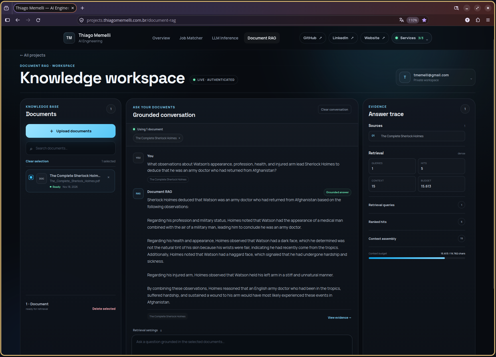

*Pergunta em inglês sobre Watson e o Afeganistão, respondida com base em um documento selecionado e acompanhada pelo Answer Trace.*

</div>

<details>
<summary><strong>Ver a jornada completa — página inicial, workspace e preparação da consulta</strong></summary>

<br>

<div align="center">

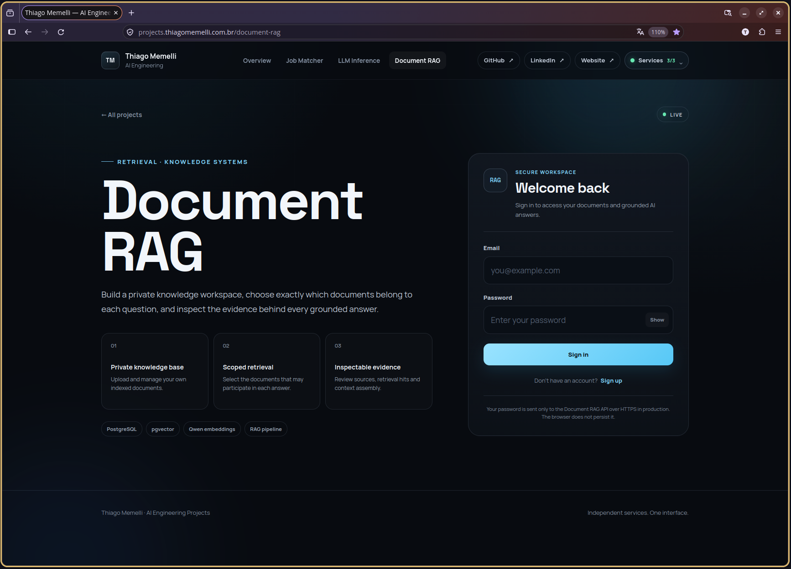

*Entrada pública do produto, proposta de valor e autenticação.*

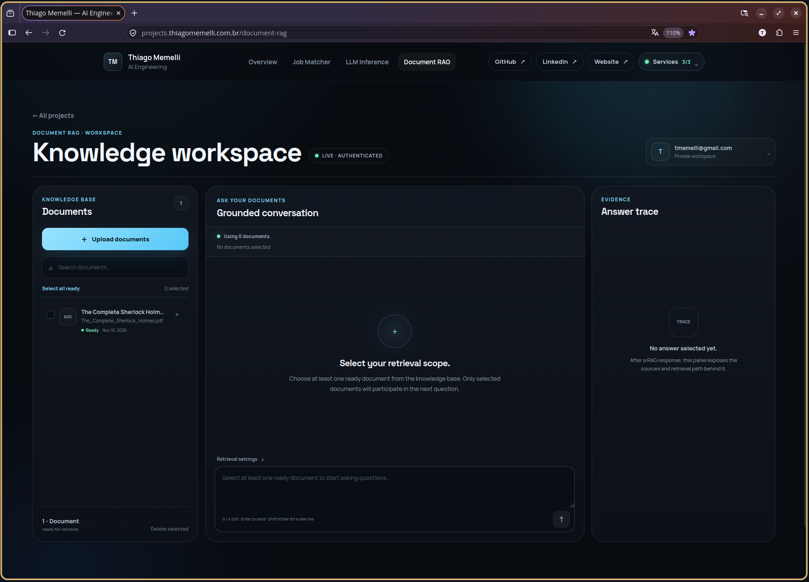

*Workspace privado: ownership, status de ingestão e escopo explícito de retrieval.*

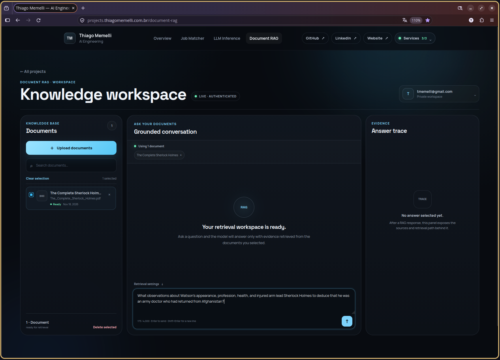

*Consulta preparada antes da execução; somente documentos selecionados participam.*

</div>

</details>

### Answer Trace — engenharia visível, não apenas a resposta

<div align="center">

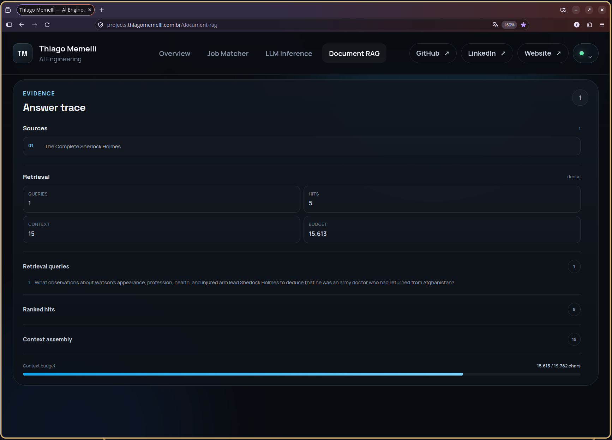

*Estratégia de retrieval, quantidade de queries, documentos selecionados, top-k e montagem do contexto.*

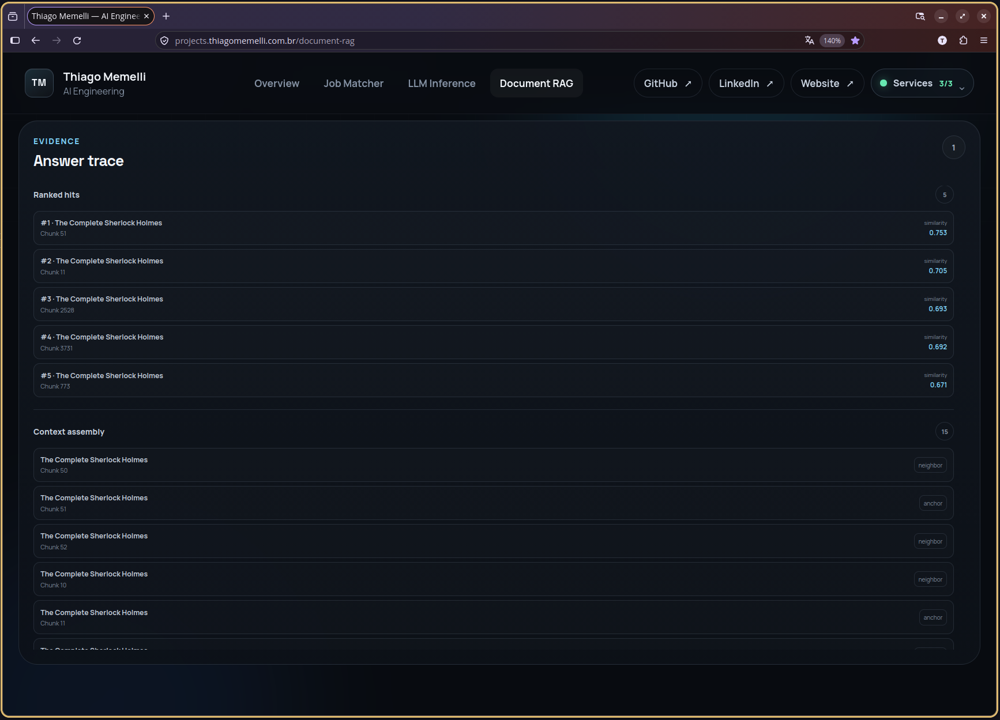

*Evidências ranqueadas, similaridades e distinção entre anchors recuperados diretamente e chunks vizinhos.*

</div>

A demonstração utiliza `limit=5` e `neighbor_window=1`: cinco anchors podem se expandir para **até 15 candidatos de contexto**, antes da deduplicação de janelas sobrepostas. O primeiro hit da demonstração é o **chunk #51**. **Nem todo candidato necessariamente chega ao LLM**: o orçamento de prompt determina o subconjunto incluído no contexto final.

O trecho do PDF original que fundamenta a resposta aparece no [estudo de caso Sherlock Holmes](#case-study).

---

## 🧩 A ideia central: RAG sem framework RAG

Este repositório não usa LangChain, LlamaIndex, Haystack ou outra camada de orquestração RAG de alto nível.

Essa foi uma decisão intencional.

O objetivo era manter o comportamento do RAG explícito no código da aplicação:

```text
Upload do documento
      │
      ▼
Validação + detecção de duplicidade SHA-256
      │
      ▼
Extração de texto
      │
      ▼
Chunking + overlap
      │
      ▼
Validação de tamanho em tokens
      │
      ▼
Provider de embeddings
      │
      ├── Local (desenvolvimento)
      │
      └── Cloudflare Workers AI (produção)
      │
      ▼
PostgreSQL + pgvector
      │
      ▼
Documento READY
```

No momento da consulta:

```text
Usuário autenticado
      │
      ▼
IDs dos documentos selecionados
      │
      ▼
Query original
      │
      ├───────────────┐
      │               │
      │          transformação
      │          opcional da query
      │               │
      │               ▼
      │         queries alternativas
      │               │
      └───────┬───────┘
              ▼
      embeddings das queries
              │
              ▼
  busca cosseno com pgvector
              │
        ┌─────┴─────┐
        │           │
        ▼           ▼
      dense      multi-query
                   + RRF
        │           │
        └─────┬─────┘
              ▼
        top-k final
              │
              ▼
     expansão por vizinhos
              │
              ▼
 priorização determinística de regiões
              │
              ▼
      budget de contexto
              │
              ▼
    LLM Inference Service
              │
              ▼
 resposta grounded + Answer Trace
```

Cada etapa pode ser inspecionada, testada, avaliada e modificada de forma independente.

---

<a id="rag-pipeline"></a>

## 🚀 O que o sistema faz

### 📚 Base privada de documentos

Cada usuário autenticado possui uma coleção privada de documentos. A API aceita os seguintes formatos:

| Formato | Extensão | Biblioteca de extração |
|---|---|---|
| PDF | `.pdf` | PyMuPDF |
| Microsoft Word | `.docx` | python-docx |
| OpenDocument Text | `.odt` | odfpy |
| Rich Text Format | `.rtf` | striprtf |
| Flat OpenDocument Text | `.fodt` | odfpy |

O limite padrão de upload é **10 MiB** (`10.485.760` bytes). O endpoint lê o arquivo em blocos limitados e rejeita arquivos vazios ou não suportados. O SHA-256 identifica conteúdo duplicado **dentro da conta do usuário**, não entre usuários diferentes.

O ciclo de vida é explícito:

```text
novo upload → pending → processing → ready
                            │
                            └── falha / cancelamento → failed
                                                         │
                               reenvio do mesmo arquivo └──→ pending → ...
```

Duplicatas em `ready` são rejeitadas; uploads que falharam podem ser tentados novamente pelo reenvio dos mesmos bytes, reutilizando o registro. Tentativas, transições e diagnósticos sanitizados são persistidos. Veja [ingestão resiliente](#ingestion).

### 🔐 Retrieval isolado por usuário

O retrieval nunca é global.

Toda consulta de documento e toda busca vetorial é filtrada pelo usuário autenticado e pelos documentos selecionados.

O frontend torna esse escopo visível: o usuário escolhe explicitamente quais documentos READY podem participar da próxima pergunta.

### 🔎 Dense retrieval

O caminho baseline:

1. gera embedding da query;
2. filtra chunks pelo usuário e pelos IDs selecionados;
3. executa busca por distância cosseno com pgvector;
4. retorna chunks ordenados e similaridades.

A estratégia é reportada como:

```text
dense
```

### 🧠 Transformação opcional da query

Perguntas mais difíceis podem ser transformadas pelo LLM Inference Service em formulações alternativas de busca.

A query original continua no conjunto.

Com a configuração atual, podem ser geradas até duas queries adicionais:

```text
query original
      │
      ├── query alternativa 1
      └── query alternativa 2
```

A transformação é best-effort: saída malformada ou falhas do provider são tentadas novamente dentro do limite configurado e, se persistirem, há fallback para a **query original**, sem derrubar toda a consulta.

Isso separa responsabilidades: o Document RAG controla retrieval; o serviço independente de inferência controla execução de modelos.

### 🔀 Multi-query + Reciprocal Rank Fusion

Quando há mais de uma query, cada uma gera sua própria lista dense.

As listas são fundidas com Reciprocal Rank Fusion:

```text
contribuição RRF = 1 / (rrf_k + rank)
```

O valor padrão de `rrf_k` é `60`.

Cada candidato final preserva:

- score RRF;
- melhor similaridade dense;
- índices das queries que encontraram aquele chunk.

A estratégia resultante é:

```text
multi_query_rrf
```

O limite padrão de candidatos por query é de pelo menos **10** (nunca menor que o `limit` final); empates de RRF são resolvidos de forma determinística por melhor similaridade e ID do chunk.

Tudo isso é implementado diretamente no `RetrievalService`.

### 🧭 Expansão por vizinhança

Um chunk semanticamente forte pode trazer somente parte da evidência.

Por isso os anchors recuperados podem ser expandidos com chunks vizinhos do mesmo documento.

Com:

```text
top_k = 5
neighbor_window = 1
```

o sistema pode montar:

```text
5 anchors × (anterior + anchor + próximo) = até 15 chunks
```

antes da deduplicação.

No Answer Trace os papéis ficam visíveis:

```text
anchor
neighbor
```

### 📖 Ordenação determinística por regiões de relevância

Uma lista ordenada por similaridade ajuda a localizar evidências, mas pode quebrar a ordem de leitura de um trecho. A **implementação atual** não ordena globalmente todos os chunks por documento. Ela:

1. Cria uma janela de chunks vizinhos **do mesmo documento** para cada anchor ranqueado.
2. Mescla janelas sobrepostas em **regiões contíguas**.
3. Atribui a cada região a prioridade de seu **anchor mais bem ranqueado**.
4. Processa regiões por prioridade semântica e ordena os chunks **dentro de cada região** por `chunk_index` crescente.

Assim preservamos a continuidade local **sem empurrar um trecho muito relevante para depois de outras partes pouco relevantes do mesmo documento**. A regra está no `ContextExpansionService` e é determinística para um ranking fixo.

```text
anchors ranqueados → janelas do mesmo documento → mesclagem
                   → regiões por prioridade do melhor anchor
                   → chunks em ordem natural dentro de cada região
```

Essa abordagem substitui o desenho anterior que agrupava globalmente o contexto inteiro por documento.

### 📏 Budget determinístico de contexto

O serviço de geração calcula quantos caracteres restam em `LLM_INFERENCE_MAX_PROMPT_CHARACTERS` **após reservar espaço para pergunta, idioma solicitado, rótulos e estrutura do prompt**. O context builder adiciona somente **chunks formatados inteiros** e interrompe a inclusão antes do primeiro que ultrapassaria o limite.

A API distingue intencionalmente:

- `context_chunks`: **todos os candidatos expandidos**, com papel `anchor` ou `neighbor`;
- `context_chunks_count`: quantidade de chunks **efetivamente incluídos** no prompt;
- `context_characters`: tamanho exato do contexto montado;
- `max_context_characters`: orçamento de caracteres disponível para o contexto.

O teto padrão é de **20.000 caracteres** para o prompt. Trata-se de um **limite em caracteres**, não de uma garantia exata de tokens do LLM remoto. Se nenhum chunk completo couber, o builder retorna erro explícito em vez de truncar silenciosamente a fonte.

### 🤖 LLM como serviço independente

O backend RAG não chama diretamente um provedor de LLM.

Ele integra via HTTP com meu projeto separado **LLM Inference Service**:

```text
Document RAG Service
        │
        │ HTTP
        ▼
LLM Inference Service
        │
        ▼
execução provider/model
```

Isso evita duplicar lógica de provedores.

O Document RAG fica responsável por ingestão, retrieval, contexto e grounding. O LLM Inference Service fica responsável por execução, resiliência, fallback e detalhes de modelo.

O system prompt instrui o modelo a usar **somente o contexto fornecido**, preservar detalhes causais concretos, responder no idioma solicitado e declarar quando as evidências forem insuficientes. É uma instrução de grounding, **não uma garantia de faithfulness medida independentemente**.

Esse desenho transformou o projeto também em um exercício de **integração entre APIs e definição de fronteiras entre serviços**.

---

## 🧪 Retrieval guiado por avaliação

Esta é uma das decisões centrais do projeto: **uma resposta convincente não é uma métrica de retrieval**. A avaliação responde a uma pergunta mais específica e reproduzível: *em qual posição aparece o primeiro chunk manualmente rotulado como relevante?*

O dataset versionado está em [`evals/retrieval_cases.json`](evals/retrieval_cases.json). Cada caso contém:

- identificador estável para comparação entre experimentos;
- pergunta em inglês;
- IDs dos documentos permitidos na busca;
- um ou mais rótulos `(document_id, chunk_index)` aceitos como relevantes.

Por exemplo, o caso Watson/Afeganistão rotula **dois chunks vizinhos** da mesma fonte indexada:

```json
{
  "id": "sherlock-watson-afghanistan-deduction",
  "query": "What observations about Watson's appearance, profession, health, and injured arm lead Sherlock Holmes to deduce that he was an army doctor who had returned from Afghanistan?",
  "document_ids": [1],
  "relevant_chunks": [
    { "document_id": 1, "chunk_index": 50 },
    { "document_id": 1, "chunk_index": 51 }
  ]
}
```

**Importante:** os IDs do banco e índices de chunk pertencem ao **corpus específico utilizado na avaliação**. Não são identificadores universais de qualquer cópia do PDF. Reindexar com outras configurações pode invalidar os rótulos.

O runner [`evals/eval_retrieval.py`](evals/eval_retrieval.py) gera o embedding de cada pergunta, executa **dense retrieval com uma única query**, identifica o primeiro chunk rotulado e calcula Hit@k e Mean Reciprocal Rank. Ele reutiliza o `RetrievalService` e o repositório pgvector reais da aplicação, em vez de criar outra lógica de ranking para a avaliação.

### Ciclo de feedback da avaliação

```text
Observar uma resposta ruim ou incompleta
                 ↓
Inspecionar hits e contexto
                 ↓
Localizar evidência no documento original
                 ↓
Registrar rótulos de relevância
                 ↓
Executar o baseline dense
                 ↓
Experimentar mudanças no retrieval
                 ↓
Comparar rankings e inspecionar novamente
```

Esse processo justifica neighbor expansion, query transformation opcional, multi-query RRF, orçamento explícito e diagnósticos do Answer Trace: **cada mecanismo pode ser analisado e testado separadamente**. A presença dessas técnicas não significa que todas tenham melhorado o baseline dense; comparações entre estratégias são um próximo passo.

---

<a id="case-study"></a>

## 🕵️ O caso Sherlock Holmes — da falha de retrieval à evidência verificável

O problema original de depuração envolvia uma pergunta muito específica sobre Sherlock Holmes: uma visitante chegando a Baker Street, pistas sobre **uma passagem de trem de volta e lama na manga esquerda**, e a dedução sobre viagem de trem e carruagem aberta. O retrieval inicial retornava passagens semanticamente relacionadas, mas nem sempre o trecho decisivo. Isso mostrou por que **uma resposta fluente pode esconder uma falha de recuperação**.

O caso de depuração motivou instrumentação, neighbor expansion e avaliação rotulada. **Ele não faz parte dos 30 casos atuais em inglês**; o baseline publicado utiliza o dataset em `evals/retrieval_cases.json`.

### Demonstração verificável na fonte: Watson e Afeganistão

A demonstração online utiliza a pergunta:

> What observations about Watson's appearance, profession, health, and injured arm lead Sherlock Holmes to deduce that he was an army doctor who had returned from Afghanistan?

O trecho original relaciona aparência de médico e postura militar à exposição aos trópicos, sinais de sofrimento e doença e uma lesão no braço esquerdo. Holmes deduz que Watson era um médico militar que voltou do Afeganistão. No ranking dense da demonstração, o **chunk #51** é o primeiro resultado; o caso de avaliação aceita os chunks **#50 e #51** como relevantes no documento indexado.

<div align="center">

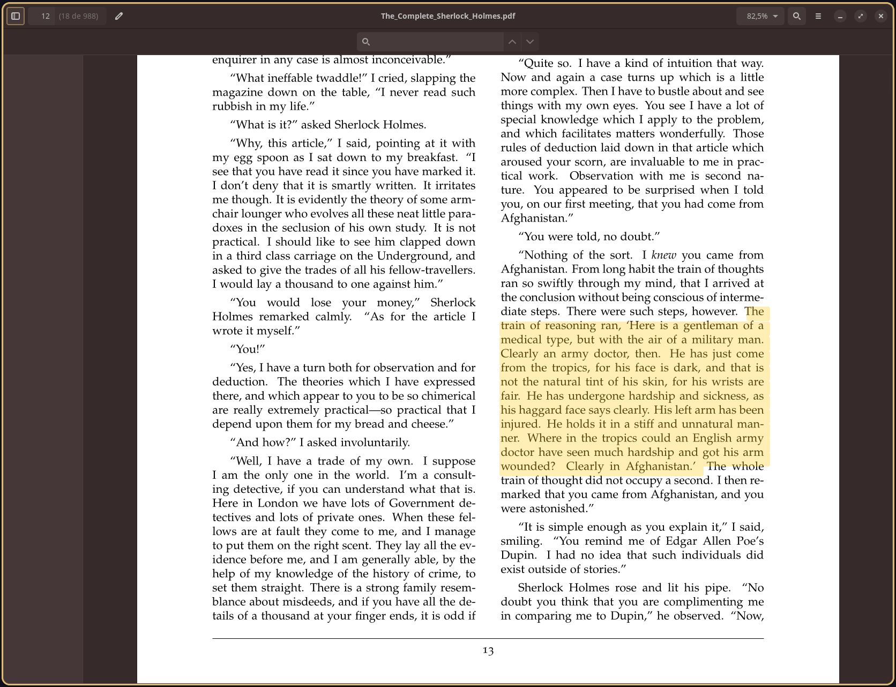

*Evidência destacada no PDF original. É uma captura do documento, não uma citação gerada pelo modelo.*

</div>

A captura mostra a **página 18 de 988 no visualizador**, correspondente à página impressa **13** do livro. Essas numerações são diferentes; a avaliação utiliza **índices de chunk começando em zero**, não páginas do PDF.

O princípio central é simples: **a passagem original, o chunk recuperado, o contexto efetivamente enviado e a resposta final devem poder ser inspecionados separadamente**. Isso vale mais do que depender apenas de uma resposta aparentemente impressionante.

---

<a id="evaluation"></a>

## 📊 Baseline de dense retrieval — 30 casos

O benchmark atual avalia **30 perguntas em inglês sobre Sherlock Holmes** utilizando **dense retrieval com uma única query por caso**. Os embeddings são gerados pelo modelo Qwen3 via Cloudflare Workers AI e armazenados com **512 dimensões** no pgvector.

<div align="center">

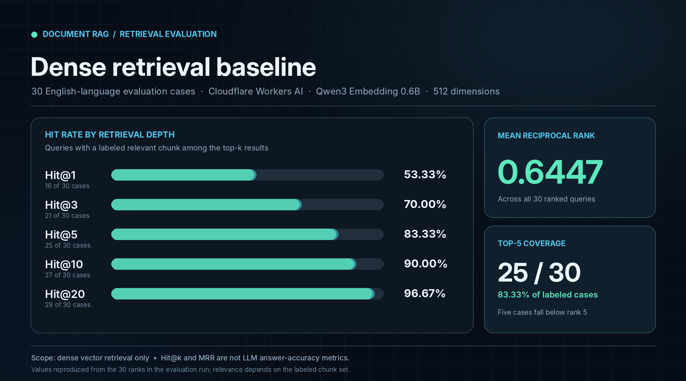

*Métricas agregadas calculadas a partir dos rankings reportados pelo runner.*

</div>

| Métrica | Resultado | Acertos rotulados |
|---|---:|---:|
| **Hit@1** | **53,33%** | 16/30 |
| **Hit@3** | **70,00%** | 21/30 |
| **Hit@5** | **83,33%** | 25/30 |
| **Hit@10** | **90,00%** | 27/30 |
| **Hit@20** | **96,67%** | 29/30 |
| **MRR** | **0,6447** | Média dos reciprocal ranks dos 30 casos |

<div align="center">

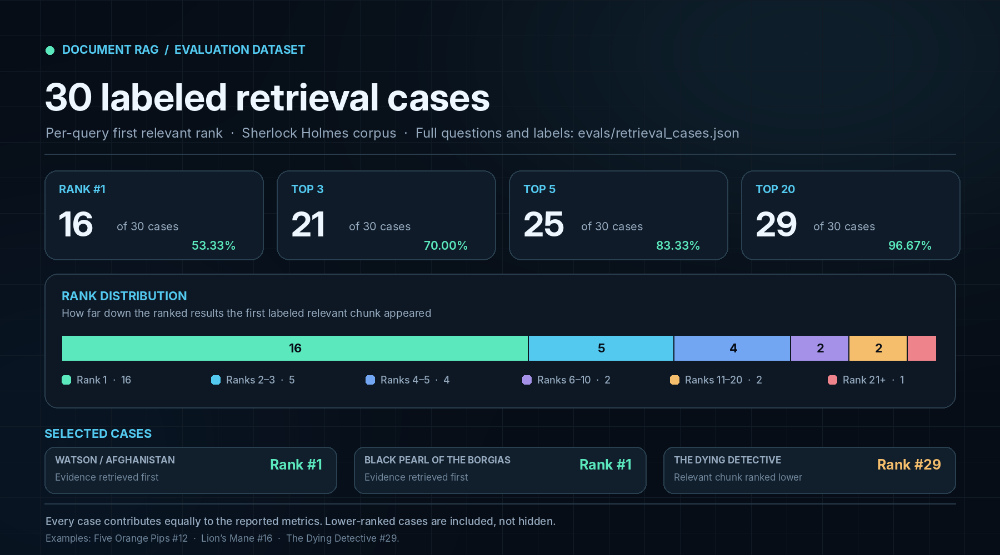

*Visão dos casos; os rótulos completos permanecem disponíveis como JSON no repositório.*

</div>

### Configuração medida

```text
strategy  = single-query dense retrieval
provider  = cloudflare
model     = @cf/qwen/qwen3-embedding-0.6b
dimension = 512
cases     = 30
```

**Definições das métricas**, para `N` perguntas e primeira posição relevante `rᵢ`:

```text
Hit@k = quantidade(rᵢ <= k) / N
MRR   = (1/N) × Σ (1/rᵢ)       [0 quando não há rank relevante]
```

O runner busca uma lista profunda o suficiente para encontrar o primeiro chunk **rotulado**. Ele não mede geração de resposta, faithfulness do prompt nem correção das citações.

### Casos que merecem análise

| Caso | Primeira posição rotulada | Interpretação |
|---|---:|---|
| Dedução sobre Watson e Afeganistão | **#1** | Evidência recuperada imediatamente |
| Pérola negra dos Borgias | **#1** | Bom resultado no topo |
| Aviso dos Five Orange Pips | **#12** | Evidência presente, mas profunda demais para um top-5 típico |
| Lion's Mane / *Cyanea* | **#16** | Ranking ainda é um gargalo |
| The Dying Detective / caixa de marfim | **#29** | Evidência fora do top 20, embora apareça depois |

**O que os números sugerem:** a evidência rotulada costuma aparecer até a posição 20 (29/30), mas apenas 16/30 casos a colocam em primeiro. Melhorar o ranking é, portanto, um próximo experimento razoável. **Isso é uma hipótese**, não prova de que reranking, busca híbrida ou decomposição de queries já foram implementados e avaliados.

### Metodologia, reprodução e limitações

- **Escopo:** somente **dense retrieval com uma query**. Query transformation e `multi_query_rrf` existem na aplicação, mas **não são medidos por esses resultados**.
- **Rótulos:** os 30 casos usam chunks manualmente selecionados. Os IDs foram comparados com uma exportação do corpus, mas os rótulos **não constituem julgamento independente e exaustivo**. Podem existir outros trechos relevantes não rotulados.
- **Dependência do snapshot:** IDs de documentos e índices de chunks dependem do corpus indexado e da configuração de chunking. Uma instalação nova precisa preparar corpus, conta e rótulos compatíveis.
- **Configuração do runner:** [`evals/eval_retrieval.py`](evals/eval_retrieval.py) ainda contém um e-mail fixo de avaliação e o JSON usa IDs fixos de documentos. Adapte para seu próprio ambiente **antes de executar ou publicar identificadores pessoais**.
- **Verificação:** os rankings foram fornecidos pela execução do projeto e a aritmética agregada foi conferida. **Não afirmamos ter executado um benchmark independente novo**.
- **Fora do escopo:** acurácia do LLM, groundedness, alucinações, latência, throughput, recall de todos os trechos relevantes e a estratégia multi-query.

```bash
# Requer banco com o corpus Sherlock indexado, usuário de avaliação
# compatível e credenciais de embedding Cloudflare.
uv run python evals/eval_retrieval.py
```

[Ver casos rotulados](evals/retrieval_cases.json) · [Ver runner](evals/eval_retrieval.py) · [Ver exportação de chunks](evals/export_chunks.py)

O objetivo do baseline não é afirmar que o retrieval está resolvido, mas oferecer um **ponto de partida medido** para futuros experimentos com os mesmos rótulos.

---

## 🔍 Observabilidade do retrieval

Uma resposta RAG é muito mais fácil de depurar quando não retornamos somente a resposta.

`POST /v1/rag/query` também expõe:

- fontes;
- estratégia de retrieval;
- queries de retrieval;
- hits ranqueados;
- IDs e títulos dos documentos;
- `chunk_index`;
- score;
- melhor similaridade;
- queries que encontraram cada chunk;
- chunks usados no contexto;
- papel `anchor` / `neighbor`;
- quantidade de chunks;
- caracteres utilizados;
- budget máximo.

É isso que alimenta o **Answer Trace**.

O usuário consegue investigar não apenas:

> "O que o modelo respondeu?"

mas também:

> "O que o retrieval pesquisou, o que foi ranqueado e qual contexto chegou à geração?"

Essa observabilidade foi uma das ferramentas mais importantes durante a evolução do projeto.

---

### Entendendo os campos do Answer Trace

| Campo | Significado |
|---|---|
| `retrieval_strategy` | `dense` ou `multi_query_rrf` |
| `retrieval_queries` | Queries normalizadas efetivamente executadas |
| `retrieval_hits` | Anchors ranqueados com score, melhor similaridade dense e índices das queries |
| `context_chunks` | Chunks **candidatos** expandidos, com papel `anchor`/`neighbor` |
| `context_chunks_count` | Quantidade de chunks completos **incluídos** no contexto do LLM |
| `context_characters` | Tamanho do contexto realmente montado |
| `max_context_characters` | Orçamento de caracteres disponível para aquela pergunta |
| `sources` | Títulos dos documentos presentes no contexto **incluído** |

**Não confunda `score` com similaridade de cosseno no modo multi-query.** Em `dense`, o score corresponde a `1 - distance`. Em `multi_query_rrf`, `score` é o **valor fundido de RRF**, enquanto `best_similarity` preserva a maior similaridade dense observada. A interface pode exibir os dois sem tratá-los como equivalentes.

O trace descreve retrieval e montagem do contexto. Ele **não garante** que cada frase da resposta final seja perfeitamente fiel às fontes; isso exige avaliação separada da geração.

---

<a id="ingestion"></a>

## 🧬 Ingestão resiliente de documentos

A ingestão foi desenhada como uma **máquina de estados recuperável**, não apenas um endpoint de upload que espera que todas as chamadas remotas terminem. A implementação separa os registros duráveis do lifecycle da transação que grava os chunks e marca o documento como pronto.

### Fluxo normal

```text
POST /v1/documents/upload
          │
          ▼
Validar nome, extensão, bytes não vazios e tamanho (10 MiB padrão)
          │
          ▼
Calcular SHA-256 e verificar duplicidade por usuário autenticado
          │
          ▼
Criar documento + histórico de pending
          │
          ▼
Extrair texto (.pdf / .docx / .odt / .rtf / .fodt)
          │
          ▼
Chunking com overlap e validação de limite por tokenizer
          │
          ▼
Claim atômico pending → processing + fencing token + lease
          │
          ▼
Gerar embeddings dos chunks (Cloudflare ou provider local)
          │
          ▼
Persistir chunks e vetores + transição fenced processing → ready
          │
          ▼
Commit dos chunks + status ready + histórico da tentativa
```

O texto é extraído, normalizado, dividido em chunks com limites em caracteres (`1000` e overlap `200` no ambiente de exemplo) e validado com o tokenizer do modelo de embedding. O provider pode realizar diversas requisições remotas; o sistema **não depende de uma única transação aberta como registro de estado durante toda a operação**.

### Lifecycle explícito e retries

```text
novo → pending → processing → ready
                         │
                         └─ falha / cancelamento → failed
                                                     │
                  reenvio do mesmo arquivo (usuário) ┘
                                     ↓
                               pending → processing → ready

processing + lease expirado/ausente
    → recuperar tentativa interrompida como failed
    → registrar interrupção e reservar nova tentativa
    → pending → processing → ready
```

- Duplicatas em `ready` são rejeitadas; uma duplicata em `pending` ou com lease **ativo** não é assumida por outra tentativa.
- Reenviar bytes idênticos após `failed` **reutiliza o mesmo ID do documento** e incrementa o número da tentativa.
- Um registro em `processing` só é recuperado quando o lease está **expirado ou ausente**; leases ativos não são tomados.
- **Não existe endpoint público `/retry`** nem daemon de recuperação contínuo. A recuperação é acionada por novo upload do mesmo conteúdo.
- O upload ainda executa a ingestão **sincronamente** na requisição HTTP; filas e workers são evoluções futuras.

### Lease, heartbeat e fencing: por que precisamos dos três?

| Mecanismo | Comportamento atual | Falha evitada |
|---|---|---|
| **Claim atômico** | Update condicional muda `pending` para `processing` | Dois workers assumirem o mesmo documento |
| **Processing lease** | Expira após **120 segundos** por padrão | Um worker morto bloquear retries indefinidamente |
| **Heartbeat** | Sessão separada renova lease a cada **30 segundos** por padrão | Chamada demorada à Cloudflare parecer abandono |
| **Fencing token** | Token único exigido nas transições para `ready`/`failed` | Worker antigo sobrescrever tentativa mais recente |
| **Attempt number** | Histórico registra cada retry e transição | Perder a linha do tempo da ingestão |

O intervalo do heartbeat precisa ser menor que a duração do lease. Se a renovação parar, o lease poderá expirar; um worker antigo não consegue confirmar resultados obsoletos depois que uma nova tentativa assumir o documento. A tarefa de heartbeat é cancelada e aguardada ao final da ingestão.

### Integridade transacional e tratamento de falhas

Na persistência, o serviço cria as linhas de chunks e executa a transição fenced `processing → ready` na mesma transação. Se embedding ou persistência falhar, ocorre rollback para que **chunks parciais não sejam mantidos como uma ingestão bem-sucedida**. O estado `failed` e os diagnósticos são registrados separadamente quando a tentativa ainda detém o token.

O código também trata `asyncio.CancelledError` explicitamente e registra uma interrupção retryable quando possível. Um crash completo do processo pode impedir esse registro imediato; o **mecanismo de recuperação por lease** existe justamente para esse cenário.

### Histórico operacional e eventos de erro estruturados

O banco mantém duas trilhas complementares:

| Tabela | O que registra |
|---|---|
| `document_status_history` | Status anterior/novo, componente, operação, número da tentativa, timestamp e detalhes JSON |
| `error_events` | Classificação, código, operação, retryability, tentativa, documento/correlation ID opcionais e detalhes estruturados |

Falhas conhecidas da Cloudflare são decompostas em campos como provider, HTTP status, provider code e provider message. As mensagens são limitadas em tamanho e padrões comuns de credenciais são redigidos antes da persistência. Isso permite investigar falhas **sem depender apenas dos logs temporários do Render**.

Esses controles atacam um problema real de produção: uma ingestão interrompida poderia deixar um documento preso em `processing`, mesmo após o usuário tentar novamente. O protocolo torna esse estado diagnosticável e recuperável.

---

## ☁️ Arquitetura de embeddings e batching adaptativo da Cloudflare

A aplicação expõe um contrato `EmbeddingProvider` com implementações local e Cloudflare. O restante do pipeline RAG depende desse contrato, não do formato HTTP ou SDK específico de um fornecedor.

### Produção: Cloudflare Workers AI

| Configuração | Valor no `.env.example` enviado |
|---|---|
| Provider de embeddings | `cloudflare` |
| Modelo remoto | `@cf/qwen/qwen3-embedding-0.6b` |
| Tokenizer correspondente | `Qwen/Qwen3-Embedding-0.6B` |
| Dimensão armazenada | `512` |
| Maior batch tentado | `32` textos |
| Limite de sequência | `8192` tokens do tokenizer |
| Timeout HTTP | `30` segundos |
| Máximo de tentativas transitórias | `3` |

A Cloudflare executa a inferência de embeddings remotamente. A aplicação usa `AutoTokenizer` do Hugging Face **localmente para contar tokens** antes de enviar os chunks; a API em produção **não carrega o modelo local para inferência**.

O provider envia documentos no campo `documents` e consultas no campo `queries`, valida estrutura e quantidade de vetores, trunca os embeddings para a dimensão configurada e aplica normalização L2. A coluna atual do banco é explicitamente `Vector(512)`, portanto mudar a dimensão exige migração coordenada e planejamento de reindexação.

### Por que a contagem local de tokens não resolveu o tamanho do request?

O limite medido pelo tokenizer protege **chunks individuais**, mas a Cloudflare pode rejeitar o **payload agregado** de vários textos individualmente válidos. Tratar `32` como batch sempre seguro gerou uma falha real do provider: **HTTP 400 / código 3030 (`input too big`)**.

A solução foi o **adaptive batching**. O batch configurado virou um **limite superior otimista**, e não uma garantia sobre o tamanho aceito pelo provider:

```text
Tentar batch de documentos (até 32 textos)
                    │
            Resposta da Cloudflare
                    │
        ┌───────────┴────────────────┐
        │                            │
      sucesso               HTTP 400 / código 3030
        │                            │
 validar vetores          dividir batch pela metade
        │                       ┌────┴────┐
 devolver em ordem         esquerda    direita
                                │         │
                             recurse   recurse
                                └────┬────┘
                             concatenar em ordem
```

Um único texto grande demais não pode ser dividido na camada de **batch** e falha explicitamente; a camada de chunking/limite de tokens existe para prevenir isso. A divisão recursiva processa a metade esquerda antes da direita, preservando a associação entre chunk e embedding.

### Erros transitórios são outro tipo de problema

O provider **não** repete indefinidamente erros determinísticos de tamanho. Ele aplica retries limitados a **HTTP 408, 429 e 500–504**, além de falhas de transporte. Respeita `Retry-After` numérico quando disponível; caso contrário usa exponential backoff.

| Falha | Tratamento |
|---|---|
| HTTP 400 + código Cloudflare `3030` | Dividir recursivamente batch de documentos |
| HTTP 408 / 429 / 500–504 | Retry limitado com atraso |
| Falha de rede/transporte | Retry limitado com exponential backoff |
| JSON inválido, quantidade incorreta ou estrutura malformada | Falha explícita; nada de sucesso parcial silencioso |
| Um único texto ainda grande demais | Falha explícita para registro pela ingestão |

A distinção de engenharia é importante: **contagem local de tokens, tamanho agregado do request e disponibilidade temporária do provider são três problemas diferentes**, com soluções diferentes.

### Desenvolvimento: provider local opcional

A implementação local permanece disponível para experimentos:

```bash
uv sync --extra local
```

Configure `EMBEDDING_PROVIDER=local` e um dispositivo compatível (por exemplo `cpu` sem CUDA). A produção utiliza Cloudflare para não instalar nem executar o stack pesado de inferência local em uma instância pequena do Render. Os dois caminhos precisam produzir vetores compatíveis com a dimensão pgvector; mudar provider/modelo pode exigir reindexação.

---

## 🛡️ Autenticação, isolamento e proteção da API

A aplicação pública é multiusuário.

O projeto inclui:

- autenticação JWT;
- validação de issuer e audience;
- expiração configurável;
- senhas com Argon2;
- validação de e-mail;
- ownership por usuário;
- retrieval filtrado por usuário;
- documentos de outros usuários escondidos via `404`;
- limite de tamanho de upload;
- detecção de duplicidade por SHA-256;
- CORS;
- rate limit de cadastro;
- rate limit de login;
- rate limit de upload;
- rate limit de RAG;
- exclusão de conta;
- limpeza em cascade dos dados associados.

Valores padrão atuais:

```text
cadastro: 3 / minuto
login:    5 / minuto
upload:   3 / minuto
RAG:      5 / minuto
```

---

### Limites de proteção e ressalvas

- **JWT:** tokens bearer assinados são validados por assinatura, issuer, audience e expiração; senhas usam **Argon2**. `AUTH_JWT_SECRET` exige **pelo menos 32 caracteres**.
- **Ownership:** operações com documentos e busca vetorial são limitadas ao usuário autenticado. IDs de outros usuários não expõem seus dados.
- **Uploads:** extensões suportadas, leitura incremental com limite padrão de 10 MiB e detecção de duplicidade SHA-256 por usuário.
- **CORS:** apenas origins configuradas podem ler respostas cross-origin da API.
- **Rate limiting:** o sliding-window limiter atual é **local ao processo**. Serve para a implantação atual, mas **não é distribuído** entre múltiplos workers ou réplicas.
- **Exclusão:** documentos e contas (com confirmação da senha) utilizam limpeza relacional por cascade.

O `GET /health` confirma que o processo da API responde; ele não verifica profundamente PostgreSQL, Cloudflare ou o serviço de inferência. O monitor frontend respeita essa distinção.

---

## 💸 Arquitetura de produção econômica & UX global de saúde

O portfólio público utiliza uma implantação enxuta, com atenção a custos. As limitações de planos gratuitos são tratadas como **trade-offs de engenharia**, não como garantia de disponibilidade empresarial.

```text
                     https://projects.thiagomemelli.com.br
                         Frontend React / Vite unificado
                                     │
              ┌──────────────────────┼───────────────────────┐
              │                      │                       │
              ▼                      ▼                       ▼
       Document RAG API       LLM Inference API        AI Job Matcher API
        FastAPI · Render        Serviço Render           Serviço Render
              │                      ▲
       ┌──────┼────────┐             │
       │      │        │             │
       ▼      ▼        └─────────────┘
     Neon   Cloudflare      Geração de texto por HTTP
 PostgreSQL Workers AI
 + pgvector Embeddings Qwen3
```

| Componente | Responsabilidade |
|---|---|
| [Frontend unificado](https://github.com/tmemelli/projects-frontend) | Um domínio, UI consistente, rotas por projeto e monitor global |
| [API Document RAG](https://document-rag-service.onrender.com/docs) | Documentos autenticados, ingestão, retrieval, contexto e grounding |
| [LLM Inference Service](https://github.com/tmemelli/llm-inference-service) | Serviço HTTP independente para execução de modelos/providers |
| Neon PostgreSQL + pgvector | Ownership relacional, histórico e busca vetorial |
| Cloudflare Workers AI | Inferência remota de embeddings de documentos e queries |
| Render | APIs independentes com possibilidade de cold start no plano gratuito |

### Por que um frontend e backends independentes?

O `projects-frontend` oferece `/job-matcher`, `/llm-inference` e `/document-rag` no mesmo domínio e padrão visual. Cada backend preserva API, deploy e responsabilidade próprios. Isso evita duplicar hospedagem frontend e demonstra **limites entre serviços e integração por HTTP**.

### Monitor global Services — melhoria de UX para cold starts

O frontend agora possui um indicador **Services** ao lado de `Website` no header global. Ele consulta `/health` dos **três backends**, não apenas do Document RAG.

- Dispara uma rodada inicial quando o portfólio visível é aberto.
- Repete aproximadamente **a cada 10 minutos** enquanto a aba está visível, online e ativa.
- Exibe **3/3 ready** quando as três respostas verificáveis têm sucesso, além de estados individuais, último horário de verificação, contador e botão **Check now**.
- Mostra `Checking`, `Waking / slow`, `Ready`, `Unverified`, `Unavailable` ou `Paused` conforme o caso.
- Pausa em abas ocultas/offline e após **20 minutos sem interação**, evitando consumo desnecessário do free tier.
- **Não** trata uma resposta opaca `no-cors` como HTTP 200. Quando o navegador não consegue verificar, exibe **Unverified**.

Uma resposta lenta pode indicar que a instância gratuita do Render está acordando. A UI comunica essa possibilidade sem bloquear a página. O monitor é uma **melhoria de UX e warmup no navegador**, não SLA, daemon em background ou garantia de que todas as dependências estejam saudáveis.

A implementação fica no [repositório frontend](https://github.com/tmemelli/projects-frontend), não no backend RAG. É um exemplo concreto de equilíbrio entre **experiência do visitante, cold start e limite de computação compartilhada**.

---

<a id="architecture"></a>

## 🏗️ Arquitetura & estrutura do repositório

O projeto separa contratos HTTP, serviços de aplicação, repositórios de persistência, providers e configuração. A orquestração RAG permanece explícita, enquanto preocupações de infraestrutura ficam isoladas por interfaces pequenas.

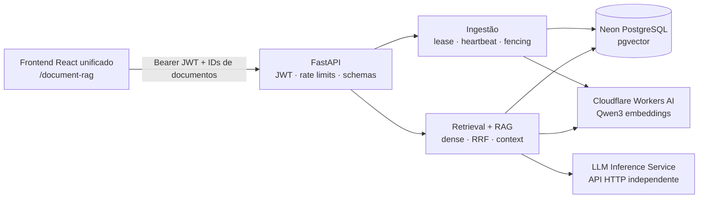

### Mapa do código

```text
document-rag-service/
├── src/document_rag_service/
│   ├── api/
│   │   ├── routes.py                   # Endpoints HTTP e validação
│   │   ├── dependencies.py             # Auth e composição por request
│   │   ├── rate_limiter.py             # Sliding window em memória
│   │   ├── exception_handlers.py
│   │   └── schemas/                    # Contratos Pydantic
│   ├── core/
│   │   ├── settings.py                 # Configuração validada
│   │   ├── lifespan.py                 # Ciclo de vida de recursos
│   │   └── embedding_provider_factory.py
│   ├── db/                             # Sessões SQLAlchemy async
│   ├── models/                         # User, document, chunk, status, errors
│   ├── repositories/                   # SQL/pgvector e updates atômicos
│   ├── providers/
│   │   ├── cloudflare_embedding_provider.py
│   │   ├── local_embedding_provider.py
│   │   └── llm_inference_provider.py
│   ├── services/
│   │   ├── document_service.py         # Ownership, checksum, reserva retry
│   │   ├── ingestion_service.py        # Extração, persistência, recuperação
│   │   ├── chunking_service.py         # Overlap e limites de tokens
│   │   ├── embedding_service.py        # Contrato de provider
│   │   ├── retrieval_service.py        # Dense search e RRF
│   │   ├── query_transformation_service.py
│   │   ├── context_expansion_service.py
│   │   ├── context_builder_service.py
│   │   ├── generation_service.py
│   │   ├── rag_service.py              # Orquestração ponta a ponta
│   │   └── serviços de auth/user/checksum/text
│   ├── main.py
│   └── py.typed
├── migrations/                         # Evolução do schema com Alembic
├── evals/
│   ├── retrieval_cases.json            # 30 perguntas em inglês e rótulos
│   ├── eval_retrieval.py               # Avaliação do ranking dense
│   ├── embedding_benchmark.py
│   └── export_chunks.py
├── tests/
│   ├── unit/
│   ├── integration/
│   └── manual/                         # Scripts de debug/smoke
├── docs/assets/                       # Prints reais e gráficos de avaliação
├── .env.example
├── alembic.ini
├── pyproject.toml
├── uv.lock
├── README.md
└── README.pt-BR.md
```

### Responsabilidades das camadas

| Camada | Responsabilidade |
|---|---|
| `api` | Rotas HTTP versionadas, schemas, dependências bearer, validação, rate limits, erros |
| `services` | Orquestração dos casos de uso, lifecycle, retrieval, contexto, geração |
| `repositories` | Consultas SQL/pgvector por usuário, claims atômicos e updates fenced |
| `models` | Schema SQLAlchemy e integridade relacional |
| `providers` | Embeddings Cloudflare/local e integração HTTP com LLM externo |
| `core` / `db` | Settings, lifespan e sessões async de banco |
| `evals` | Dataset rotulado, runner de baseline e utilitários de inspeção |
| `tests` | Testes unitários, integração PostgreSQL e verificação manual |

### Integridade do banco e migrations

O Alembic acompanha a evolução do schema, incluindo usuários/ownership, chunks e embeddings, histórico de status, erros estruturados, cascades, migração para vetores de 512 dimensões e leases de processamento. No snapshot de código recebido, a migration mais recente é **`4f8c1a2d9b73`**. Utilize `uv run alembic upgrade head` em vez de criar tabelas manualmente no deploy.

Cada chunk é único no documento por `(document_id, chunk_index)`; as foreign keys usam cascade quando apropriado. O retrieval faz join com os documentos do usuário para impor controle de acesso na própria consulta.

---

## 🛠️ Stack Tecnológica

| Área | Tecnologia | Finalidade |
|---|---|---|
| Linguagem | Python 3.12+ | Implementação principal |
| API | FastAPI | HTTP assíncrono, DI e OpenAPI |
| ORM | SQLAlchemy 2 | Persistência assíncrona |
| Banco | PostgreSQL | Usuários, documentos e metadata |
| Vector search | pgvector | Busca por distância cosseno |
| Migrations | Alembic | Evolução versionada do schema |
| Embeddings | Qwen3 Embedding | Vetores de documentos/queries |
| Embeddings em produção | Cloudflare Workers AI | Inferência remota |
| Embeddings locais | sentence-transformers | Caminho opcional de desenvolvimento |
| Tokenização | Transformers `AutoTokenizer` | Tokenizer compatível e contagem |
| HTTP | httpx | Cloudflare + serviço de LLM |
| Validação | Pydantic / pydantic-settings | Schemas e configuração |
| Senhas | Argon2 | Hash de credenciais |
| Autenticação | JWT | Bearer token stateless |
| PDF | PyMuPDF | Extração |
| DOCX | python-docx | Extração |
| ODT/FODT | odfpy | Extração |
| RTF | striprtf | Extração |
| Testes | pytest + pytest-asyncio | Unitários e integração |
| Coverage | pytest-cov | Cobertura |
| Tipagem | mypy | Verificação estática |
| Linting | Ruff | Qualidade |
| Pacotes | uv | Ambiente e lockfile |

---

<a id="api"></a>

## 🌐 API & exemplos

<div align="center">

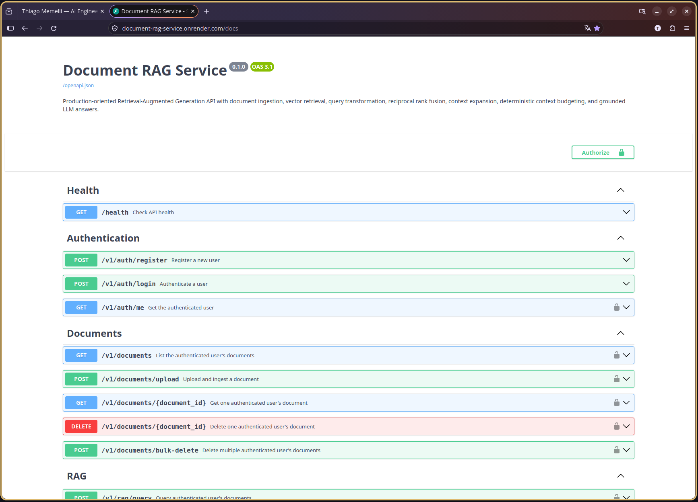

*Documentação OpenAPI online: [Swagger UI](https://document-rag-service.onrender.com/docs).*

</div>

| Método | Endpoint | Finalidade |
|---|---|---|
| `GET` | `/health` | Health check leve do processo |
| `POST` | `/v1/auth/register` | Criar usuário e emitir bearer token |
| `POST` | `/v1/auth/login` | Autenticar e emitir bearer token |
| `GET` | `/v1/auth/me` | Retornar usuário autenticado |
| `GET` | `/v1/documents` | Listar documentos próprios |
| `POST` | `/v1/documents/upload` | Upload, ingestão síncrona ou retry de conteúdo que falhou |
| `GET` | `/v1/documents/{document_id}` | Ler metadados de documento próprio |
| `DELETE` | `/v1/documents/{document_id}` | Excluir documento próprio |
| `POST` | `/v1/documents/bulk-delete` | Validar e excluir múltiplos documentos próprios |
| `POST` | `/v1/rag/query` | Resposta fundamentada e diagnósticos de retrieval |
| `POST` | `/v1/account/delete` | Excluir conta com confirmação de senha |

### Fluxo de autenticação

Cadastro e login recebem JSON com e-mail/senha e retornam `access_token`, `token_type: bearer` e dados públicos do usuário. Rotas protegidas exigem `Authorization: Bearer <access_token>`. As senhas não são armazenadas em texto puro.

```bash
# Exemplo: use sua conta e a URL local da API.
curl -X POST http://127.0.0.1:8000/v1/auth/login \
  -H 'Content-Type: application/json' \
  -d '{"email":"user@example.com","password":"replace-with-your-password"}'
```

### Upload de documento

```bash
curl -X POST http://127.0.0.1:8000/v1/documents/upload \
  -H "Authorization: Bearer $ACCESS_TOKEN" \
  -F 'file=@/path/to/your-document.pdf' \
  -F 'title=My knowledge source'
```

A API escolhe o parser pela extensão. `title` é opcional. Upload duplicado de documento `ready` é rejeitado; reenviar conteúdo que falhou pode iniciar outra tentativa no mesmo ID.

### Executar uma consulta fundamentada

```json
{
  "document_ids": [1],
  "query": "What observations about Watson's appearance, profession, health, and injured arm lead Sherlock Holmes to deduce that he was an army doctor who had returned from Afghanistan?",
  "language": "en",
  "limit": 5,
  "neighbor_window": 1,
  "transform_query": false
}
```

```bash
curl -X POST http://127.0.0.1:8000/v1/rag/query \
  -H "Authorization: Bearer $ACCESS_TOKEN" \
  -H 'Content-Type: application/json' \
  -d '{"document_ids":[1],"query":"What observations lead Holmes to deduce that Watson returned from Afghanistan?","language":"en","limit":5,"neighbor_window":1,"transform_query":false}'
```

O schema aceita **1–100 IDs de documentos**, perguntas de até **4.000 caracteres**, `limit` entre **1–20** e `neighbor_window` entre **0–5**. `transform_query` é opcional e inicia como `false`. Os documentos selecionados precisam pertencer ao usuário e estar em `ready`.

### Contrato de observabilidade da resposta

```text
answer
sources
retrieval_strategy
retrieval_queries
retrieval_hits[]:
  document_id, document_title, chunk_index,
  score, best_similarity, matched_query_indexes
context_chunks[]:
  document_id, document_title, chunk_index, role
context_chunks_count
context_characters
max_context_characters
```

O consumidor pode mostrar apenas a resposta ou usar os campos extras para explicar evidências ranqueadas e candidatos de contexto. A API atual retorna **títulos de documentos de origem**, não um mapa de citações formalmente verificado frase por frase.

---

## ✅ Testes, qualidade & estratégia de verificação

O repositório contém **testes unitários, integração real com PostgreSQL/pgvector e scripts manuais de smoke test**. A estratégia evoluiu junto com a aplicação: primeiro validar o comportamento no stack local, depois consolidar testes automatizados antes do deploy.

### O que é coberto

| Área | Exemplos de comportamento testado |
|---|---|
| Autenticação e API | Cadastro/login, JWT, ownership, exclusão de conta, rate limits |
| Lifecycle | Validação de upload, duplicidade por checksum, retries, transições |
| Recuperação | Claims atômicos, expiração de lease, heartbeat, fencing, cancelamento e rollback |
| Cloudflare | Resposta do provider, split adaptativo no código `3030`, retries e normalização |
| Retrieval | Busca pgvector por usuário, ranking dense, RRF multi-query, desempates determinísticos |
| Contexto | Neighbor windows, regiões mescladas, prioridade semântica, budget de chunks inteiros |
| Geração | Prompt, idioma, limites de contexto e erros do provider |
| Banco | Constraints PostgreSQL/SQLAlchemy reais, cascade e integração dos repositórios |
| API ponta a ponta | Documentos autenticados e contrato de resposta RAG |

### Executar a suíte automatizada

```bash
# Requer PostgreSQL local e banco exclusivo para integração.
uv run pytest

# Lint, formatação e tipagem estática.
uv run ruff check .
uv run ruff format --check .
uv run mypy src tests

# Medição atualizada de cobertura (não um número histórico do README).
uv run pytest --cov=src/document_rag_service --cov-report=term-missing
```

**Segurança dos testes de integração:** `tests/integration/conftest.py` restringe testes a hosts PostgreSQL locais e usa o banco dedicado **`document_rag_test_db`**, com rollback e savepoints. Crie e migre esse banco separadamente; **nunca aponte os testes para Neon em produção**.

### Smoke tests manuais

A pasta `tests/manual/` possui scripts de debug para ingestão, queries, RAG completo e cadastro. São úteis para validar o comportamento real de provider/banco após mudanças de arquitetura ou configuração.

```bash
# Exemplo: consulte os argumentos dos scripts antes de executar.
uv run python tests/manual/debug_query.py --help
uv run python tests/manual/debug_ingestion.py --help
```

### O que afirmamos — e o que não afirmamos

READMEs antigos traziam totais históricos específicos de testes e cobertura. Esses números **não são repetidos aqui** porque esta revisão da documentação não executou novamente a suíte inteira nem gerou um relatório novo. Os comandos acima são os quality gates reproduzíveis; os totais atuais devem ser publicados somente com a respectiva saída dos testes.

Da mesma forma, o benchmark de retrieval mede ranking contra rótulos, não cobertura de testes unitários nem correção da resposta gerada. Manter essas medições separadas faz parte da disciplina de avaliação do projeto.

---

## ⚙️ Configuração

As configurações são carregadas pelo `pydantic-settings` a partir de variáveis de ambiente e do `.env`, com validação na inicialização. O [`.env.example`](.env.example) versionado é o template de referência; **nunca publique credenciais reais**.

### Banco, HTTP e limites

| Variável | Exemplo / padrão | Finalidade |
|---|---|---|
| `POSTGRES_HOST`, `POSTGRES_PORT`, `POSTGRES_DB` | `localhost`, `5432`, `document_rag_db` | Local do PostgreSQL |
| `POSTGRES_USER`, `POSTGRES_PASSWORD` | `document_rag_user`, placeholder | Credenciais do banco |
| `POSTGRES_SSLMODE` | `prefer` no exemplo | Política TLS; ajuste ao banco |
| `CORS_ALLOWED_ORIGINS` | localhost + domínio do portfólio | Origins com leitura da API |
| `DOCUMENT_UPLOAD_MAX_SIZE_BYTES` | `10485760` | Limite de 10 MiB |
| `AUTH_REGISTER_RATE_LIMIT_PER_MINUTE` | `3` | Limite de cadastro |
| `AUTH_LOGIN_RATE_LIMIT_PER_MINUTE` | `5` | Limite de login |
| `DOCUMENT_UPLOAD_RATE_LIMIT_PER_MINUTE` | `3` | Limite de upload |
| `RAG_RATE_LIMIT_PER_MINUTE` | `5` | Limite de consultas |

### Ingestão e embeddings

| Variável | Valor de exemplo | Finalidade |
|---|---|---|
| `CHUNK_SIZE` | `1000` | Máximo aproximado de caracteres por chunk |
| `CHUNK_OVERLAP` | `200` | Overlap em caracteres |
| `DOCUMENT_PROCESSING_LEASE_SECONDS` | `120` | Lease de ownership da ingestão |
| `DOCUMENT_PROCESSING_HEARTBEAT_SECONDS` | `30` | Intervalo de renovação, menor que lease |
| `EMBEDDING_PROVIDER` | `cloudflare` | `cloudflare` ou `local` |
| `EMBEDDING_MODEL` | `Qwen/Qwen3-Embedding-0.6B` | Identificador de tokenizer/modelo local |
| `EMBEDDING_DIMENSION` | `512` | Dimensão de vetores; schema do banco fixa 512 |
| `EMBEDDING_DEVICE` | `cuda` | Dispositivo local; use `cpu` quando necessário |
| `CLOUDFLARE_ACCOUNT_ID` / `CLOUDFLARE_API_TOKEN` | placeholders | Obrigatórios com Cloudflare |
| `CLOUDFLARE_EMBEDDING_MODEL` | `@cf/qwen/qwen3-embedding-0.6b` | Modelo remoto |
| `CLOUDFLARE_EMBEDDING_MAX_SEQUENCE_LENGTH` | `8192` | Limite individual de tokens |
| `CLOUDFLARE_EMBEDDING_BATCH_SIZE` | `32` | Batch máximo otimista |
| `CLOUDFLARE_TIMEOUT_SECONDS` | `30.0` | Timeout HTTP |
| `CLOUDFLARE_MAX_ATTEMPTS` | `3` | Retries transitórios |
| `CLOUDFLARE_RETRY_BASE_DELAY_SECONDS` | `1.0` | Base do exponential backoff |

### LLM, transformação de query e JWT

| Variável | Valor de exemplo | Finalidade |
|---|---|---|
| `LLM_INFERENCE_BASE_URL` | `https://llm-inference-service-g4os.onrender.com` | API de inferência independente |
| `LLM_INFERENCE_PROVIDER` | `gemini` no `.env.example` | Provider configurável em runtime |
| `LLM_INFERENCE_MODEL` | `gemini-3.1-flash-lite` no `.env.example` | Modelo configurável em runtime |
| `LLM_INFERENCE_TEMPERATURE` | `0.0` | Temperatura de geração |
| `LLM_INFERENCE_MAX_TOKENS` | `2000` | Teto de tokens de saída |
| `LLM_INFERENCE_TIMEOUT_SECONDS` | `120.0` | Timeout HTTP de inferência |
| `LLM_INFERENCE_MAX_PROMPT_CHARACTERS` | `20000` | Teto de caracteres do prompt |
| `QUERY_TRANSFORMATION_MAX_GENERATED_QUERIES` | `2` | Queries alternativas opcionais |
| `QUERY_TRANSFORMATION_MAX_ATTEMPTS` | `2` | Tentativas antes do fallback |
| `AUTH_JWT_SECRET` | placeholder | Segredo com **mínimo de 32 caracteres** |
| `AUTH_JWT_ALGORITHM` | `HS256` | Algoritmo de assinatura |
| `AUTH_JWT_ISSUER` | `document-rag-service` | Issuer JWT |
| `AUTH_JWT_AUDIENCE` | `document-rag-frontend` | Audience JWT |
| `AUTH_ACCESS_TOKEN_EXPIRE_MINUTES` | `480` | Duração do token |

**Distinção de providers:** a classe `Settings` possui valores padrão para algumas opções, enquanto `.env.example` traz a configuração ilustrativa desejada. Os **valores efetivos em execução** vêm do ambiente; o README não afirma qual provider/modelo está atualmente selecionado no Render.

**Validação de inicialização:** `AUTH_JWT_SECRET=change-me` é um placeholder **inválido como segredo operacional**; substitua por valor aleatório de pelo menos 32 caracteres. Os placeholders da Cloudflare também precisam ser trocados se `EMBEDDING_PROVIDER=cloudflare`.

---

<a id="quick-start"></a>

## ⚡ Início Rápido

### Pré-requisitos

- Python **3.12+** e [`uv`](https://docs.astral.sh/uv/).
- PostgreSQL com extensão **pgvector** habilitada.
- Acesso a um [LLM Inference Service](https://github.com/tmemelli/llm-inference-service) compatível para geração ponta a ponta.
- Credenciais Cloudflare Workers AI **ou** ambiente de embeddings local.

### 1. Clone e instale

```bash
git clone https://github.com/tmemelli/document-rag-service.git
cd document-rag-service
uv sync
```

Para inferência local opcional de embeddings:

```bash
uv sync --extra local
```

### 2. Configure o ambiente

```bash
cp .env.example .env
```

Edite `.env` com seu PostgreSQL, **novo segredo JWT com no mínimo 32 caracteres**, provider de embeddings e endereço do LLM service. O `.env.example` é um template, **não uma configuração pronta com segredos válidos**.

Sem credenciais Cloudflare, altere para `EMBEDDING_PROVIDER=local`, instale o extra e configure `EMBEDDING_DEVICE` compatível (`cpu` sem CUDA). Não misture modelos/vetores incompatíveis no mesmo índice já existente.

### 3. Prepare PostgreSQL e migrations

Habilite pgvector no banco de destino (uma vez, com privilégios adequados):

```sql
CREATE EXTENSION IF NOT EXISTS vector;
```

Depois aplique o schema versionado:

```bash
uv run alembic upgrade head
```

### 4. Inicie a API

```bash
uv run uvicorn document_rag_service.main:app --reload
```

Abra **[http://127.0.0.1:8000/docs](http://127.0.0.1:8000/docs)** para o Swagger ou consulte `GET http://127.0.0.1:8000/health`.

### 5. Exercite o fluxo

1. Cadastre-se ou faça login no Swagger e copie o bearer token.
2. Envie um documento suportado e aguarde a resposta da ingestão síncrona.
3. Confirme status `ready` e anote o ID do documento.
4. Envie `POST /v1/rag/query` com esse ID, query em inglês, `limit=5` e `neighbor_window=1`.
5. Inspecione `retrieval_hits`, `context_chunks`, `context_chunks_count` e a resposta.

### 6. Testes e avaliação opcionais

```bash
# Use um banco PostgreSQL local dedicado à integração.
uv run pytest
uv run ruff check .
uv run ruff format --check .
uv run mypy src tests

# Somente após preparar corpus/usuário Sherlock compatíveis.
uv run python evals/eval_retrieval.py
```

Para a interface React pública, consulte o [repositório projects-frontend](https://github.com/tmemelli/projects-frontend). O backend isolado expõe API HTTP e Swagger; o frontend não está embutido no pacote Python.

---

## 🧠 Decisões de Engenharia

### Por que PostgreSQL + pgvector?

O projeto já precisa de dados relacionais para usuários, ownership, documentos, status, histórico e erros. O pgvector permite manter busca vetorial próxima desses dados e aplicar ownership na mesma camada de persistência.

### Por que não usar um framework RAG?

Porque a intenção do projeto era entender as decisões.

Implementar diretamente tornou possível investigar ranking, limites de candidatos, RRF, neighbor window, ordenação, budget, fontes e falhas.

Em outro projeto, um framework de alto nível pode ser a escolha correta. Aqui ele esconderia justamente o que eu queria aprender.

### Por que RRF?

Multi-query gera listas ranqueadas independentes cujas similaridades não precisam estar calibradas entre si. RRF permite fusão por posição de ranking sem exigir essa calibração.

### Por que neighbor expansion?

O melhor chunk pode conter somente parte da resposta. Expandir ao redor do anchor recupera continuidade local sem precisar aumentar o número inicial de hits.

### Por que ordenar contexto após retrieval?

Similaridade é uma boa ordem de ranking, não necessariamente uma boa ordem de leitura. Ordenar naturalmente **dentro de regiões contíguas priorizadas por relevância** entrega ao LLM um contexto local mais coerente sem perder a prioridade semântica entre regiões.

### Por que serviço de LLM separado?

Retrieval e inferência são responsabilidades diferentes. O backend RAG depende de um contrato HTTP estável em vez de carregar integrações com provedores de modelo dentro do mesmo projeto.

### Por que manter um baseline dense?

Porque toda melhoria precisa de algo estável para comparar. Sem baseline, "melhorou" vira opinião.


### Por que lease, heartbeat e fencing token?

Um campo de status sozinho não distingue uma ingestão ativa de um processo que caiu durante uma chamada remota. O lease permite recuperar ownership abandonado; o heartbeat protege trabalho legítimo demorado; o fencing token impede um worker antigo de confirmar depois que outro assumiu. São **partes diferentes do mesmo problema de concorrência**.

### Por que batching adaptativo e não apenas contagem local de tokens?

O tokenizer limita textos individuais, mas os limites do provider podem depender do payload agregado. O erro Cloudflare `3030` expôs essa diferença. Divisão recursiva resolve rejeição determinística de tamanho, enquanto retries limitados tratam falhas HTTP temporárias. Não devemos classificar todos os erros do provider como equivalentes.

### Por que persistir histórico de status e eventos de erro?

Um status `failed` sozinho não revela se a falha ocorreu em extração, tokenização, embedding ou persistência, nem se um retry substituiu uma tentativa interrompida. Tentativas, transições e diagnósticos sanitizados permitem investigar sem depender exclusivamente de logs voláteis.

### Por que Answer Trace como contrato de API?

Uma resposta pode soar correta mesmo quando o chunk decisivo não foi recuperado ou não coube no prompt. Expor queries, anchors ranqueados, candidatos expandidos, quantidade incluída e títulos de origem torna o pipeline auditável e melhora debug e avaliação.

### Por que monitor global em vez de keep-alive permanente?

O portfólio utiliza serviços gratuitos que podem dormir. O monitor ativo apenas durante o uso do visitante melhora a UX **enquanto alguém está no site** e pausa quando a aba fica oculta ou ociosa. Isso equilibra cold start e horas gratuitas, sem prometer uptime contínuo.

### Por que não tratar métricas de retrieval como qualidade da resposta?

Hit@k e MRR medem onde aparece a **evidência rotulada** no dense retrieval. Não dizem se o LLM usou essa evidência fielmente, se as citações sustentam cada frase ou se outra estratégia é melhor. Respeitar o escopo de cada métrica é essencial para Engenharia de IA confiável.

---

## 🧭 O que eu quero melhorar a seguir

Este projeto não é apresentado como um benchmark finalizado.

Ele é um sistema em evolução.

Os próprios evals já mostram onde existem oportunidades.

### Retrieval

- reranking com cross-encoder;
- busca híbrida BM25 + dense;
- comparação formal dense vs. multi-query RRF;
- `top_k` dinâmico;
- candidate limits dinâmicos;
- query decomposition.

### Chunking

- chunking semântico;
- segmentação por headings/seções;
- estratégias diferentes por formato;
- metadata mais rica.

### Avaliação

- faithfulness;
- answer relevance;
- context precision / recall;
- detecção de hallucination;
- relatórios comparativos entre estratégias;
- regression gates.

### Produção

- ingestão em background;
- filas;
- streaming;
- rate limiting distribuído;
- cache;
- tracing;
- métricas;
- CI com avaliação automática.

A diferença agora é que essas evoluções podem ser medidas contra um dataset e um pipeline observável.

---

## 🎯 O que este projeto demonstra

Este repositório não quer demonstrar somente que eu sei usar embeddings.

Ele reúne:

- engenharia de IA;
- retrieval;
- desenho de evals;
- Python assíncrono;
- APIs;
- PostgreSQL + vetores;
- autenticação;
- isolamento multiusuário;
- integração entre serviços;
- tratamento de falhas;
- testes;
- deploy;
- trade-offs de custo.

Principalmente, ele registra o processo de encontrar uma falha de retrieval, transformá-la em um caso mensurável e usar os resultados para decidir o próximo passo técnico.

É exatamente essa mentalidade que estou desenvolvendo: **não apenas fazer uma funcionalidade de IA funcionar, mas aprender a medir, explicar e melhorar o sistema que existe por trás dela.**

---

<div align="center">

### Projeto de portfólio em Engenharia de IA

**Thiago Memelli**

[Document RAG Online](https://projects.thiagomemelli.com.br/document-rag) •
[LLM Inference Service](https://projects.thiagomemelli.com.br/llm-inference) •
[Portfólio](https://thiagomemelli.com.br)

</div>
